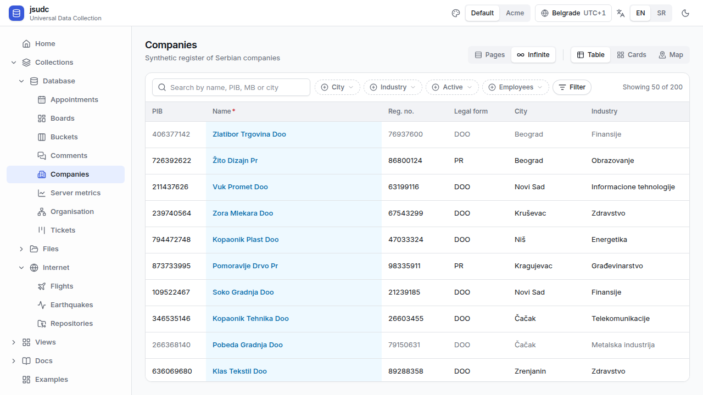
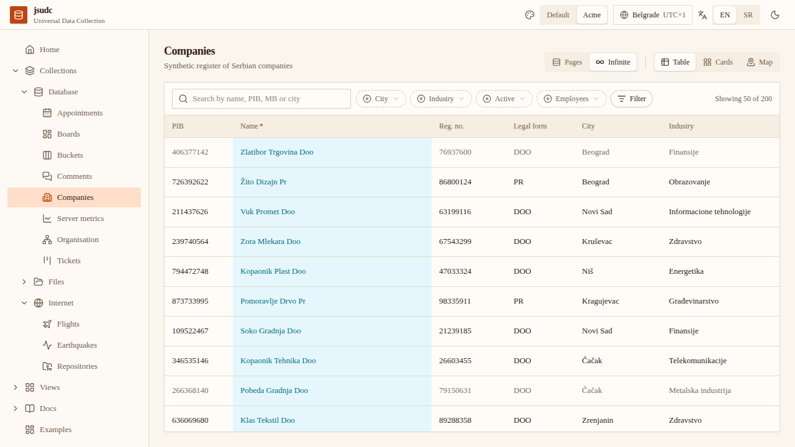
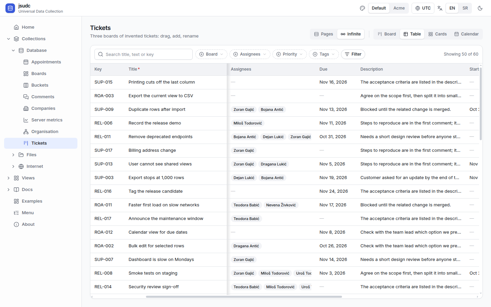
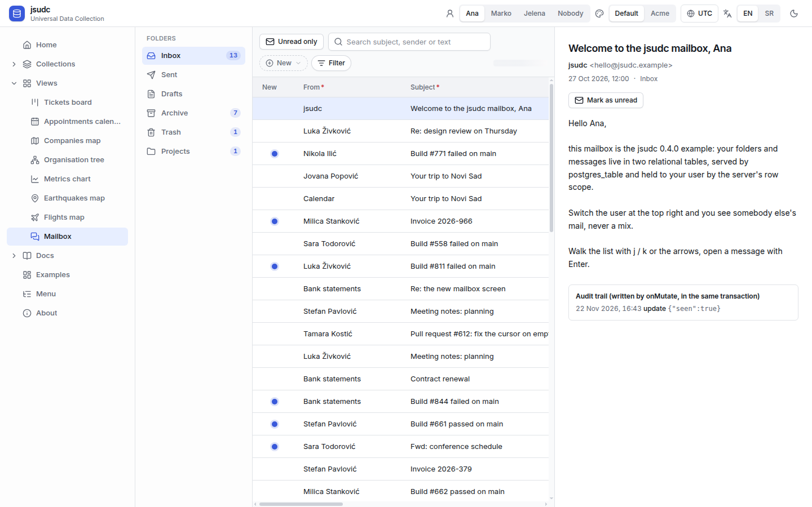
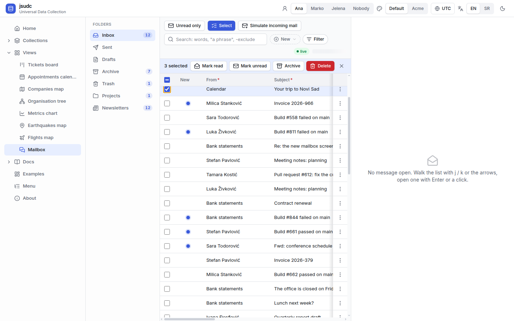

# jsudc-example

This repository is **the example app of the jsudc libraries** and nothing else.
jsudc re-implements the core of DigitalCube's **UDC (Universal Data Collection)**
in TypeScript: a Node.js backend (Fastify + Drizzle), a React frontend (Vite) and
Postgres, with collection rows stored mostly as `jsonb`. A collection is described
by a schema document and a view config (`schema.json` and `view.yaml`, the same
dialect as dclabs). The server serves it through one generic protocol: `describe`,
`list` with server-side filter/sort/paging, `mutate`, and schema edits that add a
column from the UI.

The libraries live in their own repositories:

| package | repository | what it is |
|---|---|---|
| `@jsudc/core` | [digital-cube/jsudc-core](https://github.com/digital-cube/jsudc-core) | the shared protocol, once: envelopes, the filter DSL and an in-memory evaluator, schema and view types, row validation and every action payload as Zod schemas with inferred types, plus the transport client (`@jsudc/core/client`); since 0.5.0 `mutate_many`, `defineHostAction`, `ListRequest.search` and the change feed's `ChangeEvent` / `UdcClient.changes`; since 0.6.0 the view keys `default_sort`, `hidden` / `columns_mode`, column `sortable`, `width: fill` / `grow` / `min_width` / `hide_below`, and `describe.sortable` |
| `@jsudc/server` | [digital-cube/jsudc-server](https://github.com/digital-cube/jsudc-server) | dispatcher, collection registry, the six sources (`postgres_table` since 0.4.0), schema revisions, seeding, the request context and row scope, `onMutate`, the Fastify plugin; since 0.5.0 `mutate_many`, typed host actions (`Dispatcher.register`), search answered by the source and the change feed (`createChangeFeed`, `GET /udc/changes`); since 0.6.0 `PostgresTableSource` `defaultSort`, hidden columns and `columns_mode` in `describe`, and `describe.sortable.fields` |
| `@jsudc/react` | [digital-cube/jsudc-react](https://github.com/digital-cube/jsudc-react) | hooks, `<UdcDataView>` and its seven renderers (one subpath each), embedding and row activation, custom cells, sessions, the default UI kit, the router adapter, the schema editor, i18n, theme tokens and a compiled stylesheet (global or scoped); since 0.5.0 selection and the bulk bar, row actions, `useUdcAction` / `useUdcMutateMany`, live updates (`UdcProvider changes`, `useUdcChanges`) and windowed long lists; since 0.5.1 (a patch of react alone) the row count and the pager of a source without a total (`total_count: false`); since 0.6.0 `chrome` toolbar flags, `default_sort` / `defaultSort`, hidden columns, plain headers for fields the source does not sort, flexible column widths and `TBL_<COLLECTION>.EMPTY_*` |

The point of the exercise is the **shared interface**: in UDC today the protocol is
declared twice, once in Python and once in TypeScript, and the two drift; in jsudc
both the server and the browser import `@jsudc/core`. `backend/` is the example
server that serves the demo collections with `@jsudc/server`; `frontend/` is the
example app around `@jsudc/react`. Both use the libraries the way any outside
project does (see [How the example uses the libraries](#how-the-example-uses-the-libraries)).
The example also proves the first two of the library's layers a host can
enter (plan §4.3, since 0.2.0), on the same `/udc/companies` view. **The
default kit:** `UdcProvider` without a `kit`, the compiled
`@jsudc/react/styles.css` (every utility `udc:`-prefixed) beside the shell's own
Tailwind, and the renderers registered one by one from their subpaths. **A
restyle by CSS variables:** the header's Default / Acme switch puts
`data-brand="acme"` on `<html>`, and `frontend/src/brand.css` redefines only
custom properties under it (colours, semantic tones, chart series, radius,
font), so not a line of component code changes. The Examples page in the menu
explains both and links to each.





**Lookups and drill-down** (0.3.0). A field can hold the key of a row in
another collection and show that row's label: in `tickets`, `board_id` and
`bucket_id` are `lookup`s on `boards` and `buckets`, and `assignees` is a
`lookup_array` on `org`, edited with a search combobox. The table shows names,
not ids, each a link to the row it names; the Board and Assignee chips filter
by label while the URL keeps the keys; one `list` per lookup field resolves a
whole page. `boards` has a `row_link`: a click on a board opens its tickets.
The server checks every lookup and link against the target's schema when it
starts. All of it is configuration (`tickets/schema.json`,
`boards/view.yaml`); [docs/demo.md](docs/demo.md#lookups-and-drill-down-tickets--boards-buckets-org-boards--tickets)
walks through it.



**A mailbox per user** (0.4.0), at `/mail`: a screen written in the example
— a folder list and a reading pane — around an embedded
`<UdcDataView collection="mail_messages">`. It shows what 0.4.0 adds:

- **Request context and row scope.** There is no login: the header's user
  switcher (Ana, Marko, Jelena, Nobody) picks a demo user, which `UdcClient`
  sends in `x-demo-user` through its per-call `headers` function. The
  server's `context` (`backend/src/mail/context.ts`) reads it and its
  `rowScope` holds `mail_folders`, `mail_messages` and `mail_audit` to
  `owner = <that user>`, hidden from `describe`. Another user's message is
  `not_found`, as if it did not exist; no user on a mailbox collection is
  `forbidden` with `details.reason: "unauthenticated"`, which the view shows
  as "You are signed out". The other collections need no user and are
  unscoped.
- **`postgres_table`.** The mailbox lives in three relational tables with
  typed columns and UUID ids (migration `0006`), not in `jsonb`. The folders'
  unread and total counts are computed fields, the messages are joined to
  their folder (`folder_name`, read-only), and `mail_messages` has
  `total_count: false`.
- **`onMutate`.** Every change of a message writes a row into `mail_audit`
  in the same transaction; the reading pane lists them under the message.
- **Embedding and row activation.** The open folder is the view's `filter`,
  `chrome="embedded"`, an *Unread only* button sits in `toolbarStart`, the
  view's URL state is under `urlPrefix="list."`, and `activeRowId`,
  `onActiveRowChange` and `onRowActivate` drive the reading pane: `j` / `k`
  and the arrows walk the list, Enter or a click opens (and marks seen).
- **A custom cell.** The `seen` column is drawn by `render: unread_dot`, a
  cell the example registers (`frontend/src/mail/cells.tsx`).

[docs/demo.md](docs/demo.md#the-mailbox-mail-context-and-scope-postgres_table-onmutate-an-embedded-view)
walks through it; it is the model a host such as a mail client copies.



**What 0.5.0 adds to the mailbox**, each part the way a host would use it
([docs/demo.md](docs/demo.md#what-050-adds-selection-row-actions-host-actions-live-updates-source-search-a-long-list)
has what to click):

- **Selection and bulk actions.** The view declares `multiselect` and
  `bulk_actions` (`backend/collections/mail_messages/view.yaml`); the
  toolbar's *Select* turns selection on with `UdcDataView selectable`.
  *Mark read* / *Mark unread* carry `set` (a `mutate_many` update, no code),
  *Delete* is built in, *Archive* runs a handler of the example's
  (`actions={{ archive }}`) that calls the host action below. With the
  page selected, "Select all that match" switches to the filter minus the
  unticked rows; the messages have no total (`total_count: false`), so it
  shows no number and the server reports what it changed.
- **Row actions.** `row_action_defs` in a menu (`row_actions_display: menu`):
  the dots, a right-click, Shift+F10 or `.`; each entry only where its `when`
  holds (no *Mark read* on a read message, no *Archive* in the Archive).
- **A host action, typed end to end.** `mail.move_to_folder` is defined once
  with `defineHostAction` in `shared/` (the workspace `@jsudc/shared`, which
  both sides import), registered with `Dispatcher.register` in
  `backend/src/mail/actions.ts` (it reads the target folder and runs one
  `mutate_many` under the caller's context and scope) and called with
  `useUdcAction` from the reading pane's *Move to…* and the *Archive*
  handler.
- **Live updates.** `createChangeFeed()` on the dispatcher, `UdcProvider
  changes` in the app. *Simulate incoming mail* calls a second host action
  that writes a message straight into the table and tells the feed with
  `changes.notify(…, { ctx })`: the list and the Inbox count update without
  a reload, and another user's open mailbox hears nothing.
- **Search answered by the source.** Migration `0007` adds a generated,
  GIN-indexed `tsvector`; the messages' source has the `search` option, so
  the search box sends `search` and the rows come best match first
  (web-search syntax: `"a phrase"`, `-word`).
- **A long list.** Each user's *Newsletters* folder holds 5,000 messages;
  the list is infinite and windowed (`virtualize`): a few dozen rows in the
  page however far it scrolls.

On `@jsudc/react` 0.5.1 the list's toolbar also says how many messages are
loaded: the messages have no total, and up to 0.5.0 that count stayed a
loading skeleton. Now it reads *Showing 50+* while a full page says there
may be more and *Showing 12* once a folder is all loaded
(`frontend/cypress/e2e/mail-051.cy.ts`).



The design is in
[`docs/superpowers/specs/2026-10-18-jsudc-design.md`](docs/superpowers/specs/2026-10-18-jsudc-design.md).
Until phase 1 of the libraries plan the three packages were developed inside this
repository; that history is in its git log and in each library's repository.

## Layout

```
shared/              @jsudc/shared: the mailbox's host actions (defineHostAction), imported by both sides
backend/             the example server: the demo collections (backend/collections), their eight
                     jsonb tables and the three mailbox tables (src/db/schema.ts), drizzle
                     migrations (drizzle/), the generators (scripts/), the seed CLI, the
                     mailbox's context, scope, sources and host actions (src/mail)
frontend/            the example app (React 19 + Vite): the shell (menu, pickers, about page),
                     routes, the /mail screen (src/mail) and the demo dictionary (src/i18n),
                     around @jsudc/react
scripts/e2e.mjs      the Cypress run, end to end
deploy/              the stage dev stack on examples.stage.jsudc.dev (nginx vhost, systemd unit, deploy.sh)
docs/                design, plans and the two-minute demo script (docs/demo.md)
```

## From a clean clone to a running app

Requires Node 24 (pinned in `.nvmrc`), Postgres on localhost with the role `jsudc`
(password `123`, `CREATEDB`; see [Backend](#backend) to point elsewhere). No GitHub
account or token: the libraries come from npmjs.org (see below).

```sh
git clone https://github.com/digital-cube/jsudc-example.git && cd jsudc-example
nvm use                    # Node 24
npm ci                     # installs @jsudc/core, server and react from npmjs.org, already built
npm run db:setup           # create jsudc + jsudc_test, apply the drizzle migrations to both
npm run seed -- --reset    # every database collection: schema revision 1 + its seed rows
npm run dev                # backend :5100, Vite :5173
```

Open <http://localhost:5173/udc/companies>; every collection is in the sidebar,
and <http://localhost:5173/mail> is the mailbox.

## Install and test

```sh
npm run typecheck  # tsc --noEmit in backend and frontend
npm run lint       # Biome, one config for the whole repo
npm test           # Vitest in backend and frontend (backend needs Postgres)
npm run build      # the frontend's vite build
npm run format     # Biome, rewrites files
```

`npx vitest` at the root runs both workspaces' tests as Vitest projects; inside a
workspace, `npm test` runs only that one.

## How the example uses the libraries

`backend/` depends on `@jsudc/core` and `@jsudc/server`, `frontend/` on
`@jsudc/core` and `@jsudc/react`. They come **from npmjs.org**, like any other
dependency: `backend/package.json` and `frontend/package.json` name `^0.8.0`
for each (the three are released together; `^0.7.x` does not accept 0.8.0, and
the `@jsudc/core` peer range of server and react is `^0.8.0`). `npm ci` downloads the published
tarballs (already built, `dist` included) and `package-lock.json` pins their
version and integrity. No GitHub credential is involved. `@jsudc/server` and
`@jsudc/react` take `@jsudc/core` as a peer dependency, so npm installs a single
copy of each. Since `@jsudc/server` 0.7.0 everything that needs `pg` (`connect`,
`Db`, `collectionTable`, `seedCollection`, the Postgres sources) comes from
`@jsudc/server/postgres`, and `pg` is the backend's own dependency. The sources live in their own repositories:
[digital-cube/jsudc-core](https://github.com/digital-cube/jsudc-core),
[digital-cube/jsudc-server](https://github.com/digital-cube/jsudc-server) and
[digital-cube/jsudc-react](https://github.com/digital-cube/jsudc-react).

The packages resolve through their `exports` to the built `dist`; there is no path
alias to a library's source anywhere (not in `vite.config.ts`, `vitest.config.ts`
or any `tsconfig.json`). To change a library, change it in its repository, publish
a release to npm, and bump the version here.

The frontend uses `@jsudc/react` as its CHANGELOG's 0.2.0 migration asks (unchanged in 0.3.0, 0.4.0, 0.5.0, 0.5.1, 0.6.0, 0.7.0 and 0.8.0):
`frontend/src/index.css` imports the compiled `@jsudc/react/styles.css` (the
library's utilities, all `udc:`-prefixed) and, for the shell's own unprefixed
Tailwind, `@jsudc/react/tokens.css`; it does not scan the package.
`frontend/src/App.tsx` mounts `UdcReactRouterUrlState` from
`@jsudc/react/react-router` under the router, with `collectionPath`
(`/udc/<collection>`) so that lookup links and `row_link`s become routes, and `frontend/src/renderers.ts`
registers the seven renderers explicitly (`createRendererRegistry` with
`@jsudc/react/table`, `/cards`, `/kanban`, `/calendar`, `/tree`, `/map`,
`/chart`). The primitives the shell uses (`Button`, `Segmented`, …) come from
`@jsudc/react/ui`.

Since 0.4.0, `App.tsx` also builds the `UdcClient` with a `headers` function
(the demo user, read before every request), the query client with
`createUdcQueryClient({ onUnauthenticated })` (the user switcher lights up
when the server says "not signed in"), and mounts `UdcProvider` with
`cells={EXAMPLE_CELLS}` (`createCellRegistry`, the mailbox's `unread_dot`).
The backend passes `context` to the plugin and `rowScope` to
`createDispatcher` (`backend/src/main.ts`) and builds the mailbox's
`PostgresTableSource`s in code (`backend/src/sources.ts`); every other
collection is still exactly what its `source.yaml` says, unscoped.

Since 0.5.0 the backend gives `createDispatcher` a change feed
(`createChangeFeed()`, the in-process bus: one server process) and registers
the mailbox's host actions on it (`registerMailActions`); the plugin then
serves `GET /udc/changes`, which Vite's dev proxy forwards (it is a GET, so it
has a rule of its own beside the POSTs). The frontend wraps the routes in a
`UdcProvider changes` keyed by the demo user (`DemoUserFeed` in `App.tsx`):
the server fixes a stream's row scope when it opens, so a new user gets a new
stream. The host actions are defined once in `shared/` (`@jsudc/shared`, a
workspace whose `exports` point at its TypeScript source; `tsx` and Vite read
it directly). A host that changes nothing keeps 0.4.0's behaviour: with no app
change, the 16 specs of 0.4.0 passed on 0.5.0 before any of this was added.

The example keeps the global `styles.css`, not `@jsudc/react/styles.scoped.css`:
its pages are the library's own, and the library asks for one of the two,
never both (the scoped sheet declares the tokens on each view's root, which
would override the Acme brand and a host's `:root` tokens inside every view).
A host that embeds the message list in pages of its own, with its own base
CSS, imports `@jsudc/react/styles.scoped.css` instead, once, and restyles on
`.udc-data-view, .udc-scope`; nothing in `src/mail/` depends on which sheet
is loaded.

## Backend

Needs Postgres on localhost with the role `jsudc` (password `123`, `CREATEDB`).
Defaults live in [`backend/.env.example`](backend/.env.example); copy it to
`backend/.env` to override `DATABASE_URL`, `TEST_DATABASE_URL` or `PORT` (5100).

```sh
npm run db:setup   # create jsudc + jsudc_test, apply the drizzle migrations to both
npm run seed       # every collection: schema revision 1 + its rows, and the mailbox (-- --reset, --limit N, --db <url|name>)
npm run dev        # http://localhost:5100, OpenAPI UI at /docs
npm test -w @jsudc/backend           # the demo collections' tests, against the same database
npm run test:cov -w @jsudc/backend   # coverage, thresholds 80%
```

Every action is `POST /udc/<action>` with the payload as body; the answer is
always HTTP 200 with `{kind: "udc.<action>.ok" | "udc.<action>.err", id, payload}`.

```sh
curl -s localhost:5100/udc/list -H 'content-type: application/json' \
  -d '{"collection":"companies","sort":[{"field":"employees","dir":"desc"}],"page":{"limit":5}}'
```

The schema is editable at runtime: `schema.add_field`, `schema.update_field` and
`schema.soft_delete_field` each write a new active revision (`v2`, `v3`, …) into
`udc_schema_revisions` and create the expression index of every `index: true`
field; `seed -- --reset` returns a collection to its `schema.json` as `v1`.

```sh
curl -s localhost:5100/udc/schema.add_field -H 'content-type: application/json' \
  -d '{"collection":"companies","name":"website","fielddef":{"type":"string","length":120},"position":{"where":"after","anchor":"name"}}'
```

Collections are directories under `backend/collections/<name>/` (`view.yaml`,
`schema.json`, `seed.json`), each served from a table of the same name with every
field in `data jsonb` — except the mailbox (`mail_folders`, `mail_messages`,
`mail_audit`): `source.yaml` says `postgres_table`, the tables have typed
columns, and `backend/src/mail/sources.ts` builds the sources in code (a join,
computed fields, `onMutate`, the full-text `search`). `npm run seed` fills them with
`backend/scripts/generate-mail.ts` (per demo user six folders and 300
messages, and a seventh, *Newsletters*, with 5,000, added wherever it is
missing even without `--reset`); a mailbox request needs a demo user:

```sh
curl -s localhost:5100/udc/list -H 'content-type: application/json' -H 'x-demo-user: ana' \
  -d '{"collection":"mail_messages","sort":[{"field":"received_at","dir":"desc"}],"page":{"limit":5}}'
```
 `backend/scripts/generate-companies.ts` regenerates the
synthetic `companies` seed deterministically.

## Frontend

```sh
npm run dev        # backend (:5100) and Vite (:5173) together; open /udc/companies
npm run dev:web    # Vite only, proxying POST /udc/* and /healthz to 127.0.0.1:5100
npm test -w @jsudc/frontend   # the shell's tests (menu, sidebar groups, about page)
npm run e2e        # Cypress headless on 4 workers, each with its own reseeded database (see below)
```

Vite listens on `VITE_PORT` (5173; it moves to the next free port if that one is
taken). The dev proxy targets `UDC_PROXY_TARGET` (default `http://127.0.0.1:5100`);
setting `VITE_UDC_URL` instead makes the browser call that backend directly.
Only POSTs under `/udc` are proxied (`GET /udc/<collection>` is an app route),
plus two GETs: the file preview `/udc/files/blob` and the change feed `/udc/changes`.

`frontend/src/`: `main.tsx`, `App.tsx` (providers and routes), `shell/` (AppShell,
MenuTree, TimezonePicker, AboutPage) and `i18n/messages.ts`, the example's strings
(`COLLECTIONS`, `ABOUT`, `MENU`, `TBL_<collection>`, the shell's own `APP` terms),
passed to `<UdcI18nProvider messages>`. Vite and `tsc` resolve `@jsudc/core` and
`@jsudc/react` to their installed `dist` (see above); `src/index.css` runs Tailwind over
the shell and the library's `dist` with `@jsudc/react/tokens.css`.

Everything the user picks lives in the URL (`?q=` search, `?cf=` chips and `?f=`
filter tree as base64url JSON, `?sort=field:dir,…`, `?mode=pages|infinite`, `?p=`,
`?tab=`). The paging mode defaults from the view's `pagination`; the user's choice
is remembered per collection in `localStorage` (`udc:paging:<collection>`).

### End-to-end tests (Cypress)

`npm run e2e` (`scripts/e2e.mjs`) migrates and reseeds a test database (200 rows),
starts a backend on it and a Vite proxying to that backend, runs `cypress run`, and
stops every server whatever happens. Spec files that edit rows reseed first.

```sh
npm run e2e > .thilo/e2e.log 2>&1                    # the whole suite, 4 workers
E2E_WORKERS=1 npm run e2e > .thilo/e2e.log 2>&1      # one worker, as before
npm run e2e -- --resume > .thilo/e2e.log 2>&1        # only the files that did not pass last time
npm run e2e -- --spec frontend/cypress/e2e/edit.cy.ts  # one file (other arguments go to Cypress)
```

- **Workers.** `E2E_WORKERS` (default 4) splits the spec files into that many groups,
  balanced by the durations the earlier runs recorded. Each worker has its own
  database (`jsudc_test_1` … `_N` next to `TEST_DATABASE_URL`, created and migrated
  when missing), its own backend and Vite ports (the first free ones from
  `E2E_BACKEND_PORT`, 5110, and `E2E_WEB_PORT`, 5310) and its own reseed command, so
  one worker's reseed never resets another's rows. Each worker's Cypress output goes to
  `.thilo/e2e-w<N>.log`; the terminal gets the progress and one summary. The exit code
  is non-zero when any worker failed. `E2E_WORKERS=1` is the old run: `TEST_DATABASE_URL`
  itself, the two ports exactly, Cypress printing to the terminal.
- **Progress.** After every spec file the run writes `.thilo/e2e-progress.json` (each
  file's status, tests passed/failed and duration, the totals, the elapsed time) and
  prints one line: `7/18 files · 41 passed, 0 failed of 115 tests · 3m12s — w2 kanban.cy.ts passed in 48s`.
  `jq .summary .thilo/e2e-progress.json` answers how far a run is from another shell.
- **Resume.** `--resume` runs only the files that did not pass in the run recorded in
  the progress file (failed, crashed, or not reached because the run was stopped) and
  keeps the passed ones as they were. A plain run starts fresh. Stop a run with Ctrl-C
  or `kill <pid>` (the `pid` is in the progress file): it stops its servers and marks
  the run interrupted. A `kill -9` leaves the servers running.
- **TMPDIR.** Cypress starts the browser with `--disable-dev-shm-usage`, so Chromium
  keeps its shared memory in `TMPDIR`. When `/tmp` is full or over the user's quota, that
  memory fails to allocate: requests end in `ERR_INSUFFICIENT_RESOURCES` and Cypress
  reports "the Electron Renderer process just crashed". So the run sets `TMPDIR` to
  `.thilo/e2e-tmp` on the checkout's disk (`E2E_TMPDIR` to put it elsewhere). Before any
  server starts it writes a 64 MB probe file there and stops with the reason ("disk quota
  exceeded", ENOSPC) when it can't, instead of letting the browser crash.
- **A Cypress that dies.** When a worker's Cypress process is killed by a signal (exit
  128 + n, e.g. 132 SIGILL from the Electron main process), the files it left unfinished
  get one more Cypress run; the summary line says so. A file that ended, passed or failed,
  is never run again.

A full run takes minutes. **Run it in the background with its output in a log**
(`npm run e2e > .thilo/e2e.log 2>&1`), and follow the log or the progress file. Don't
run it as a foreground command with a timeout: a run cut by a command limit leaves only
the files it finished, and `--resume` is what picks up after it.

## Deploy: examples.stage.jsudc.dev (stage)

<https://examples.stage.jsudc.dev> is the **dev stack with HMR**, on purpose: no
production build, no `vite preview`, no static files. TLS ends at the edge in
front of this VM (the same edge as `stage.jsudc.dev`); the VM answers on :80.
The old host `jsudc.igor.digitalcube.work` answers a 301 to the new one, from a
second `server` block in the same vhost. Everything it needs is in
[`deploy/`](deploy):

```
edge (TLS)  ->  nginx :80 examples.stage.jsudc.dev  ->  Vite 127.0.0.1:5101  ->  POST /udc/*, GET /udc/changes, /healthz  ->  Fastify 127.0.0.1:5100
                nginx :80 jsudc.igor.digitalcube.work  ->  301 https://examples.stage.jsudc.dev$request_uri
deploy/nginx/examples.stage.jsudc.dev.conf   the vhost (both server blocks); /etc/nginx/sites-enabled/ links to it
deploy/systemd/jsudc-dev.service             user unit running `npm run dev`; ~/.config/systemd/user/ links to it
```

Vite is on 5101, not 5173: podman's `rootlessport` holds 5170–5189 on this machine.
The unit runs from the root checkout `/home/digital/work/jsudc` on `main` (never a
worktree), with Node v24.19.0 from nvm hardcoded, and starts at boot through linger.

- `deploy/deploy.sh [--branch jsudc] [--reset-seed] [--no-merge]` — a normal deploy,
  from the root checkout: `git merge --ff-only jsudc`, stop the unit, `npm ci`,
  `npm run build` (the frontend), migrate, `npm run seed` (new collections only; `--reset-seed`
  reseeds everything and loses edits made on the site), start the unit, then waits
  for `/healthz` through nginx and lists one row of every database collection.
- `deploy/install.sh [--dry-run]` — once, and again whenever the unit or the vhost
  file is renamed or a link is lost: links both files into the checkout, removes the
  old link `/etc/nginx/sites-enabled/jsudc.igor.digitalcube.work` if it is still
  there, enables the unit, reloads nginx and checks linger. It refuses to run from
  anywhere but `/home/digital/work/jsudc`.

```sh
systemctl --user restart jsudc-dev
systemctl --user status jsudc-dev
journalctl --user -u jsudc-dev -f
tail -f /var/log/nginx/examples.stage.jsudc.access.log /var/log/nginx/examples.stage.jsudc.error.log
```

`DATABASE_URL` or `PORT` overrides, if ever needed, go into `backend/.env` in the
root checkout (see [`backend/.env.example`](backend/.env.example)). The unit's own
`Environment=` lines win over that file, though (the environment beats `.env`), so
moving the backend off 5100 under the unit means editing `PORT` in
`deploy/systemd/jsudc-dev.service` (and `UDC_PROXY_TARGET` for Vite's proxy).

## Deploy: examples.jsudc.dev (production)

<https://examples.jsudc.dev> is a **real build** on the VM
`digitalcube-production-websites` (hetzner2, 192.168.122.11): nginx serves the
Vite build from disk, the Fastify backend runs under a systemd user unit, the
database is the VM's own Postgres (18). TLS ends at the edge in front of that
VM; the VM answers on :80. Everything it needs is in [`deploy/`](deploy):

```
edge (TLS)  ->  nginx :80 examples.jsudc.dev
                  /             static files from ~/sites/examples.jsudc.dev/current  (SPA: try_files … /index.html)
                  /assets/      the hashed bundles, cached for a year
                  POST /udc/*   ->  Fastify 127.0.0.1:5100   (GET /udc/<collection> is an app route -> /index.html)
                  /udc/files/blob, /healthz  ->  Fastify
                Fastify: `npm start -w @jsudc/backend` under the user unit jsudc-prod,
                         DATABASE_URL from src/backend/.env -> local Postgres, database jsudc

deploy/prod.sh                            the deploy script, runs ON the VM as `digital`
deploy/nginx/examples.jsudc.dev.conf      the vhost; /etc/nginx/sites-available/examples.jsudc.dev links to it
deploy/systemd/jsudc-prod.service         the user unit; ~/.config/systemd/user/ links to it

/home/digital/sites/examples.jsudc.dev/
  src/                  the checkout, detached at origin/main; backend/.env (DATABASE_URL, mode 600) lives here
  releases/<short sha>/ one built frontend/dist per commit, the last three kept
  current -> releases/… what nginx serves, swapped atomically
  node -> ~/.nvm/versions/node/vX/bin   the Node the unit runs (the newest installed v24, re-pointed by prod.sh)
```

- `deploy/prod.sh [--install] [--ref <committish>] [--reset-seed] [--force]` — a
  normal deploy, on the VM: fetch, check out `origin/main` (refusing a commit
  that lacks the vhost or the unit), `npm ci`, `npm run build`, migrate, `npm run seed`
  (new collections only; `--reset-seed` reseeds everything and loses edits made
  on the site), copy `frontend/dist` to `releases/<short sha>/`, repoint `current`,
  restart the unit, then wait for `/healthz` through nginx, `GET /udc/companies`
  (the app), `POST /udc/collections`, one row of every database collection, and
  `/healthz` through the edge. Run again for the same commit it rebuilds nothing
  and only re-checks the site. It refuses to run as root, as another user, or on
  another host. `--ref <tag|sha>` deploys that commit instead of `origin/main`
  (a pinned build or a roll-forward).
- `deploy/prod.sh --install` — the one-time steps, harmless to repeat: Postgres
  role and database `jsudc` with a generated password written to
  `src/backend/.env`, `loginctl enable-linger digital`, link the unit, replace
  the hand-written vhost in `sites-available` with a symlink into the checkout
  (the old file stays as `examples.jsudc.dev.coming-soon`), `nginx -t`, reload;
  then a normal deploy. The first run on a fresh VM:

  ```sh
  scp deploy/prod.sh digitalcube-production-websites:/tmp/jsudc-prod.sh
  ssh digitalcube-production-websites 'bash /tmp/jsudc-prod.sh --install'
  ```

  `prod.sh` clones the repository itself; afterwards it is
  `~/sites/examples.jsudc.dev/src/deploy/prod.sh` on the VM.

**Roll back** to a previous release: `current` is a symlink and the last three
builds are kept, so repoint it and, when the backend changed too, check out that
commit and restart the unit:

```sh
cd ~/sites/examples.jsudc.dev
ls -lt releases/                                   # what is there
ln -sfn releases/<short sha> .current.tmp && mv -T .current.tmp current   # frontend only, atomic
deploy/prod.sh --ref <sha>                         # frontend + backend at that commit
```

Logs and the usual commands:

```sh
systemctl --user status jsudc-prod
systemctl --user restart jsudc-prod
journalctl --user -u jsudc-prod -f
tail -f /var/log/nginx/examples.jsudc.dev.access.log /var/log/nginx/examples.jsudc.dev.error.log
```

The unit's `Environment=` lines (`PORT=5100`, `HOST`, `NODE_ENV=production`,
`LOG_LEVEL`) win over `backend/.env`, which carries only `DATABASE_URL`. The
production database was created with the server's default collation,
`C.UTF-8` (libc), so text sorts by code point.
