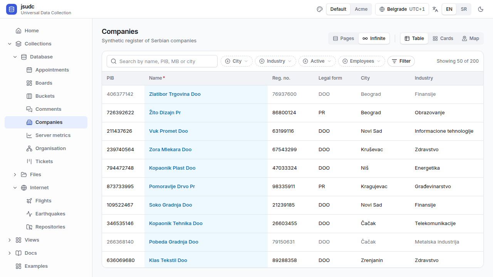
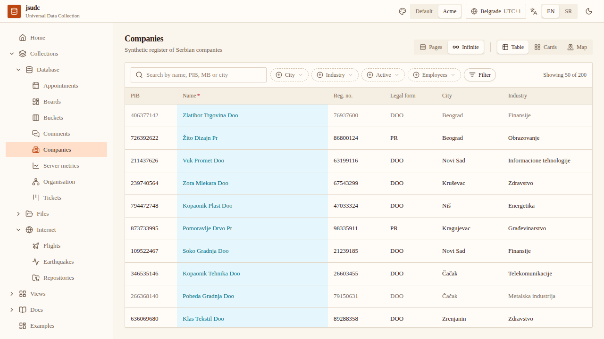

# jsudc-example

This repository is **the example app of the jsudc libraries** and nothing else.
jsudc re-implements the core of DigitalCube's **UDC (Universal Data Collection)**
in TypeScript: a Node.js backend (Fastify + Drizzle), a React frontend (Vite) and
Postgres, with collection rows stored mostly as `jsonb`. A collection is described
by a schema document and a view config (`schema.json` and `view.yaml`, the same
dialect as dclabs). The server serves it through one generic protocol: `describe`,
`list` with server-side filter/sort/paging, `mutate`, and schema edits that add a
column from the UI.

The libraries live in their own repositories:

| package | repository | what it is |
|---|---|---|
| `@jsudc/core` | [digital-cube/jsudc-core](https://github.com/digital-cube/jsudc-core) | the shared protocol, once: envelopes, the filter DSL and an in-memory evaluator, schema and view types, row validation and every action payload as Zod schemas with inferred types, plus the transport client (`@jsudc/core/client`) |
| `@jsudc/server` | [digital-cube/jsudc-server](https://github.com/digital-cube/jsudc-server) | dispatcher, collection registry, the five sources, schema revisions, seeding, the Fastify plugin |
| `@jsudc/react` | [digital-cube/jsudc-react](https://github.com/digital-cube/jsudc-react) | hooks, `<UdcDataView>` and its seven renderers (one subpath each), the default UI kit, the router adapter, the schema editor, i18n, theme tokens and a compiled stylesheet |

The point of the exercise is the **shared interface**: in UDC today the protocol is
declared twice, once in Python and once in TypeScript, and the two drift; in jsudc
both the server and the browser import `@jsudc/core`. `backend/` is the example
server that serves the demo collections with `@jsudc/server`; `frontend/` is the
example app around `@jsudc/react`. Both use the libraries the way any outside
project does (see [How the example uses the libraries](#how-the-example-uses-the-libraries)).
On `@jsudc/*` 0.2.0 the example also proves the first two of the library's
layers a host can enter (plan §4.3), on the same `/udc/companies` view. **The
default kit:** `UdcProvider` without a `kit`, the compiled
`@jsudc/react/styles.css` (every utility `udc:`-prefixed) beside the shell's own
Tailwind, and the renderers registered one by one from their subpaths. **A
restyle by CSS variables:** the header's Default / Acme switch puts
`data-brand="acme"` on `<html>`, and `frontend/src/brand.css` redefines only
custom properties under it (colours, semantic tones, chart series, radius,
font), so not a line of component code changes. The Examples page in the menu
explains both and links to each.





The design is in
[`docs/superpowers/specs/2026-10-18-jsudc-design.md`](docs/superpowers/specs/2026-10-18-jsudc-design.md).
Until phase 1 of the libraries plan the three packages were developed inside this
repository; that history is in its git log and in each library's repository.

## Layout

```
backend/             the example server: the demo collections (backend/collections), their eight
                     tables (src/db/schema.ts) and drizzle migrations (drizzle/), the generators
                     (scripts/), the seed CLI
frontend/            the example app (React 19 + Vite): the shell (menu, pickers, about page),
                     routes and the demo dictionary (src/i18n), around @jsudc/react
scripts/e2e.mjs      the Cypress run, end to end
deploy/              the dev stack on jsudc.igor.digitalcube.work (nginx vhost, systemd unit, deploy.sh)
docs/                design, plans and the two-minute demo script (docs/demo.md)
```

## From a clean clone to a running app

Requires Node 24 (pinned in `.nvmrc`), Postgres on localhost with the role `jsudc`
(password `123`, `CREATEDB`; see [Backend](#backend) to point elsewhere). No GitHub
account or token: the libraries come from npmjs.org (see below).

```sh
git clone https://github.com/digital-cube/jsudc-example.git && cd jsudc-example
nvm use                    # Node 24
npm ci                     # installs @jsudc/core, server and react from npmjs.org, already built
npm run db:setup           # create jsudc + jsudc_test, apply the drizzle migrations to both
npm run seed -- --reset    # every database collection: schema revision 1 + its seed rows
npm run dev                # backend :5100, Vite :5173
```

Open <http://localhost:5173/udc/companies>; every collection is in the sidebar.

## Install and test

```sh
npm run typecheck  # tsc --noEmit in backend and frontend
npm run lint       # Biome, one config for the whole repo
npm test           # Vitest in backend and frontend (backend needs Postgres)
npm run build      # the frontend's vite build
npm run format     # Biome, rewrites files
```

`npx vitest` at the root runs both workspaces' tests as Vitest projects; inside a
workspace, `npm test` runs only that one.

## How the example uses the libraries

`backend/` depends on `@jsudc/core` and `@jsudc/server`, `frontend/` on
`@jsudc/core` and `@jsudc/react`. They come **from npmjs.org**, like any other
dependency: each `package.json` names `^0.2.0`, `npm ci` downloads the published
tarballs (already built, `dist` included) and `package-lock.json` pins their
version and integrity. No GitHub credential is involved. `@jsudc/server` and
`@jsudc/react` take `@jsudc/core` as a peer dependency, so npm hoists a single
copy of all three to the root `node_modules`. The sources live in their own repositories:
[digital-cube/jsudc-core](https://github.com/digital-cube/jsudc-core),
[digital-cube/jsudc-server](https://github.com/digital-cube/jsudc-server) and
[digital-cube/jsudc-react](https://github.com/digital-cube/jsudc-react).

The packages resolve through their `exports` to the built `dist`; there is no path
alias to a library's source anywhere (not in `vite.config.ts`, `vitest.config.ts`
or any `tsconfig.json`). To change a library, change it in its repository, publish
a release to npm, and bump the version here.

The frontend uses `@jsudc/react` as its CHANGELOG's 0.2.0 migration asks:
`frontend/src/index.css` imports the compiled `@jsudc/react/styles.css` (the
library's utilities, all `udc:`-prefixed) and, for the shell's own unprefixed
Tailwind, `@jsudc/react/tokens.css`; it does not scan the package.
`frontend/src/App.tsx` mounts `UdcReactRouterUrlState` from
`@jsudc/react/react-router` under the router, and `frontend/src/renderers.ts`
registers the seven renderers explicitly (`createRendererRegistry` with
`@jsudc/react/table`, `/cards`, `/kanban`, `/calendar`, `/tree`, `/map`,
`/chart`). The primitives the shell uses (`Button`, `Segmented`, …) come from
`@jsudc/react/ui`.

## Backend

Needs Postgres on localhost with the role `jsudc` (password `123`, `CREATEDB`).
Defaults live in [`backend/.env.example`](backend/.env.example); copy it to
`backend/.env` to override `DATABASE_URL`, `TEST_DATABASE_URL` or `PORT` (5100).

```sh
npm run db:setup   # create jsudc + jsudc_test, apply the drizzle migrations to both
npm run seed       # companies: schema revision 1 + 200 rows (-- --reset, --limit N, --db <url|name>)
npm run dev        # http://localhost:5100, OpenAPI UI at /docs
npm test -w @jsudc/backend           # the demo collections' tests, against the same database
npm run test:cov -w @jsudc/backend   # coverage, thresholds 80%
```

Every action is `POST /udc/<action>` with the payload as body; the answer is
always HTTP 200 with `{kind: "udc.<action>.ok" | "udc.<action>.err", id, payload}`.

```sh
curl -s localhost:5100/udc/list -H 'content-type: application/json' \
  -d '{"collection":"companies","sort":[{"field":"employees","dir":"desc"}],"page":{"limit":5}}'
```

The schema is editable at runtime: `schema.add_field`, `schema.update_field` and
`schema.soft_delete_field` each write a new active revision (`v2`, `v3`, …) into
`udc_schema_revisions` and create the expression index of every `index: true`
field; `seed -- --reset` returns a collection to its `schema.json` as `v1`.

```sh
curl -s localhost:5100/udc/schema.add_field -H 'content-type: application/json' \
  -d '{"collection":"companies","name":"website","fielddef":{"type":"string","length":120},"position":{"where":"after","anchor":"name"}}'
```

Collections are directories under `backend/collections/<name>/` (`view.yaml`,
`schema.json`, `seed.json`), each served from a table of the same name with every
field in `data jsonb`. `backend/scripts/generate-companies.ts` regenerates the
synthetic `companies` seed deterministically.

## Frontend

```sh
npm run dev        # backend (:5100) and Vite (:5173) together; open /udc/companies
npm run dev:web    # Vite only, proxying POST /udc/* and /healthz to 127.0.0.1:5100
npm test -w @jsudc/frontend   # the shell's tests (menu, sidebar groups, about page)
npm run e2e        # Cypress headless against a reseeded jsudc_test (see below)
```

Vite listens on `VITE_PORT` (5173; it moves to the next free port if that one is
taken). The dev proxy targets `UDC_PROXY_TARGET` (default `http://127.0.0.1:5100`);
setting `VITE_UDC_URL` instead makes the browser call that backend directly.
Only POSTs under `/udc` are proxied: `GET /udc/<collection>` is an app route.

`frontend/src/`: `main.tsx`, `App.tsx` (providers and routes), `shell/` (AppShell,
MenuTree, TimezonePicker, AboutPage) and `i18n/messages.ts`, the example's strings
(`COLLECTIONS`, `ABOUT`, `MENU`, `TBL_<collection>`, the shell's own `APP` terms),
passed to `<UdcI18nProvider messages>`. Vite and `tsc` resolve `@jsudc/core` and
`@jsudc/react` to their installed `dist` (see above); `src/index.css` runs Tailwind over
the shell and the library's `dist` with `@jsudc/react/tokens.css`.

Everything the user picks lives in the URL (`?q=` search, `?cf=` chips and `?f=`
filter tree as base64url JSON, `?sort=field:dir,…`, `?mode=pages|infinite`, `?p=`,
`?tab=`). The paging mode defaults from the view's `pagination`; the user's choice
is remembered per collection in `localStorage` (`udc:paging:<collection>`).

`npm run e2e` (`scripts/e2e.mjs`) migrates and reseeds the test database
(`TEST_DATABASE_URL`, 200 rows), starts the backend on it at `E2E_BACKEND_PORT`
(5110) and Vite at `E2E_WEB_PORT` (5310), runs `cypress run`, and stops both. Spec
files that edit rows reseed first. Extra arguments go to Cypress, e.g.
`npm run e2e -- --spec frontend/cypress/e2e/edit.cy.ts`.

## Deploy on igor.digitalcube.work

<http://jsudc.igor.digitalcube.work> is the **dev stack with HMR**, on purpose: no
production build, no `vite preview`, no static files. Everything it needs is in
[`deploy/`](deploy):

```
nginx :80 (TLS upstream)  ->  Vite 127.0.0.1:5101  ->  POST /udc/*, /healthz  ->  Fastify 127.0.0.1:5100
deploy/nginx/jsudc.igor.digitalcube.work.conf   the vhost; /etc/nginx/sites-enabled/ links to it
deploy/systemd/jsudc-dev.service                user unit running `npm run dev`; ~/.config/systemd/user/ links to it
```

Vite is on 5101, not 5173: podman's `rootlessport` holds 5170–5189 on this machine.
The unit runs from the root checkout `/home/digital/work/jsudc` on `main` (never a
worktree), with Node v24.19.0 from nvm hardcoded, and starts at boot through linger.

- `deploy/deploy.sh [--branch jsudc] [--reset-seed] [--no-merge]` — a normal deploy,
  from the root checkout: `git merge --ff-only jsudc`, stop the unit, `npm ci`,
  `npm run build` (the frontend), migrate, `npm run seed` (new collections only; `--reset-seed`
  reseeds everything and loses edits made on the site), start the unit, then waits
  for `/healthz` through nginx and lists one row of every database collection.
- `deploy/install.sh [--dry-run]` — once, and again whenever the unit or the vhost
  file is renamed or a link is lost: links both files into the checkout, enables the
  unit, reloads nginx and checks linger. It refuses to run from anywhere but
  `/home/digital/work/jsudc`.

```sh
systemctl --user restart jsudc-dev
systemctl --user status jsudc-dev
journalctl --user -u jsudc-dev -f
tail -f /var/log/nginx/jsudc.igor.access.log /var/log/nginx/jsudc.igor.error.log
```

`DATABASE_URL` or `PORT` overrides, if ever needed, go into `backend/.env` in the
root checkout (see [`backend/.env.example`](backend/.env.example)). The unit's own
`Environment=` lines win over that file, though (the environment beats `.env`), so
moving the backend off 5100 under the unit means editing `PORT` in
`deploy/systemd/jsudc-dev.service` (and `UDC_PROXY_TARGET` for Vite's proxy).
