# jsudc in two minutes

A demo script for the phase-1 build: one collection (`companies`, 200
synthetic Serbian companies) served from Postgres jsonb through the generic
UDC path, shown as a table and as cards, with columns added from the UI.

## Before you start

```sh
nvm use
npm ci                      # installs @jsudc/* from npmjs.org, already built
npm run db:setup
npm run db:migrate -w @jsudc/backend   # once after pulling: new tables (0003 appointments … 0005 metrics, 0006 the mailbox, 0007 its full-text index)
npm run seed -- --reset     # 200 companies (with lat / lng), 3 boards / 15 buckets / 60 tickets, ~640 appointments around today, 30 days of metrics up to now, 3 mailboxes of 300 messages plus 5,000 newsletters each
npm run dev                 # backend :5100 + Vite (it prints its port)
```

Open `http://localhost:<vite port>/udc/companies`. Light/dark and EN/SR are in
the top bar; both are remembered. Every choice below lands in the address bar,
so a link (or a reload) reproduces the screen.

Re-run `npm run seed -- --reset` before showing the demo again: it also drops
the column added in step 6.

## The eight steps

1. **Browse.** The table opens with 50 of 200 rows and loads more as you
   scroll. PIB and Name are pinned; scroll sideways and a shadow appears at
   their edge. Inactive companies are muted (`row_color` in `view.yaml`).

2. **Sort.** Click the **Employees** header: ascending, again for
   descending, a third time to clear. Shift-click a second header to add it as
   a secondary sort. The sort runs on the server over the numeric jsonb cast,
   so 10 comes after 9.

3. **Filter.** Type `Beograd` in the search box: name, PIB, MB and city are
   searched, and "Showing X of Y" follows the server's total. Add the
   **Active → No** chip, then **Filter → Employees between 100 and 200**.
   Reload: the filter survives, because it is encoded in `?f=`.

4. **Switch paging.** In the top right, switch **Infinite** to **Pages**. A
   pager appears with the total and page count. Go to page 3, then switch back
   to **Infinite**. The choice is remembered per collection.

5. **Edit a cell.** Double-click a City cell (or focus it and press Enter),
   type a new value, press Enter. Escape cancels, and Tab moves to the next
   editable cell. The save carries the row version: if someone changed the row
   in the meantime, a toast says so and the cell shows their value.

6. **Add a column.** Hover the **Name** header and open its **⋮** menu, then
   **Add column after**. Type the English label `Website`; the field name
   `website` is suggested from it. Type the Serbian label `Veb sajt` and click
   **Add column**. The column appears right after Name, with no reload. Other
   things to try from here:
   - type `Web Site` as the name to see the live validation;
   - **Edit column** → **Required** shows a red star in the header;
   - **Delete column** asks first; the data stays in the database.

7. **Fill it.** Double-click a Website cell of the first row, type
   `https://orao.rs`, press Enter. Switch the language to **SR**: the header
   now reads **Veb sajt**.

8. **See it in cards.** Click **Cards**. The search, chips, filter, sort and
   paging carry over. The first company's card now has a **Website** line.
   The view lists `website` in `card_options.meta_fields`, and the cards only
   show it once the field exists. Each card has the name as title, the PIB as
   subtitle, an initials avatar, and the same formatting as the table
   (thousands separators, the ✓/✗ for Active).

## The kanban: `tickets`

Open `http://localhost:<vite port>/udc/tickets`. The **Board** tab is the
view's default; **Table** and **Cards** show the same rows.

1. **The board.** It opens on the first board, *Product roadmap*: five
   columns (Backlog, Ready, In progress, Review, Done) with their counts, cards
   with a priority edge and dot, tags, due date (red when past), assignee
   initials and the key. The toolbar says *Showing 20 of 20*: cards on this
   board. There is no paging toggle here; the board loads every card of the
   filter.
2. **Drag.** Drag the first Backlog card to the top of *In progress*. It
   stays there after a reload: the move is one `mutate update {bucket_id,
   order}` with `expected_version`. Drag a card within a column, or drag a
   column by its header to reorder the columns.
3. **Keyboard.** Tab to a card, press **Space**, move it with the arrow keys,
   press **Space** again. **Enter** opens the card.
4. **Quick-add.** *Add ticket* at the bottom of *Review*, type a title, press
   Enter. A placeholder shows until the server row arrives. Its order is the
   last card's + 100 (at the top: the first card's − 100).
5. **Columns.** The `⋯` menu of a column renames it inline; *Delete bucket*
   only works on an empty column. *Add bucket* after the last column adds
   one at the end.
6. **Boards.** Switch boards with the select in the toolbar. The board is
   `?board=<id>` in the address bar, so a link opens the same board.
7. **Search and chips.** Type `export` in the search, or pick a Priority or
   Tags chip: the board narrows to the matching cards (*Showing 1 of 20*).
8. **Collisions.** Orders are sparse (100, 200, …). If two neighbours end up
   one apart (say 100 and 101), a drop between them first calls `reindex`,
   which renumbers that column to 100, 200, …. Then the move is tried once
   more. To see it, set two orders with `mutate` and drop between them. The
   Cypress spec `kanban.cy.ts` does exactly that.

Everything the board does comes from `kanban_options` in
`backend/collections/tickets/view.yaml`, typed by `KanbanOptionsSchema` in
`udc-core`.

## Lookups and drill-down: `tickets` → `boards`, `buckets`, `org`; `boards` → `tickets`

A **lookup** field stores a key (here, the row id of another collection) and
shows that row's label. A **`row_link`** turns a row into a link to another
collection, filtered by a value of that row. Both are new in `@jsudc/*` 0.3.0.
In the example:

| collection | field | type | target | shown as |
|---|---|---|---|---|
| `tickets` | `board_id` | `lookup` | `boards`, label `name` | the board's name, a link |
| `tickets` | `bucket_id` | `lookup` | `buckets`, label `name` | the column's name, a link |
| `tickets` | `assignees` | `lookup_array` | `org`, label `name`, tooltip `title` | one chip per person, each a link; editable |
| `buckets` | `board_id` | `lookup` (the flat udc-py spelling, `ref` + `label_field`) | `boards` | the board's name |
| `boards` | — | `row_link` to `tickets`, `board_id = id` | | a click on a row opens that board's tickets |

`tickets/schema.json` and `boards/view.yaml` are the whole configuration; the
frontend has no lookup code of its own beyond one line in `App.tsx`
(`collectionPath`, so a link becomes a route). After pulling this, run
`npm run seed -- --reset` once: `assignees` used to hold names and now holds
`org` row ids.

Open `http://localhost:<vite port>/udc/tickets?tab=table`.

1. **Labels, not ids.** The *Assignees* column shows people's names as chips.
   Hover one: the tooltip is that person's title. Scroll right: *Board* and
   *Bucket* show names too (*Support desk*, *Waiting on customer*), each
   underlined on hover. In the network tab, a page of 50 tickets makes one
   `list` per target collection (`boards`, `buckets`, `org`, with `id in
   [...]`), not one per cell.

   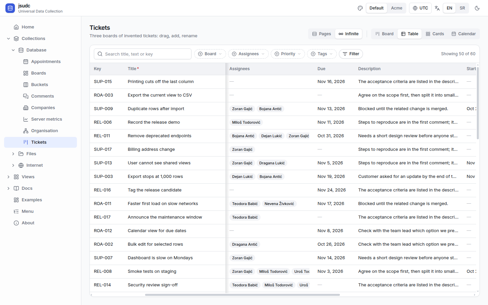

   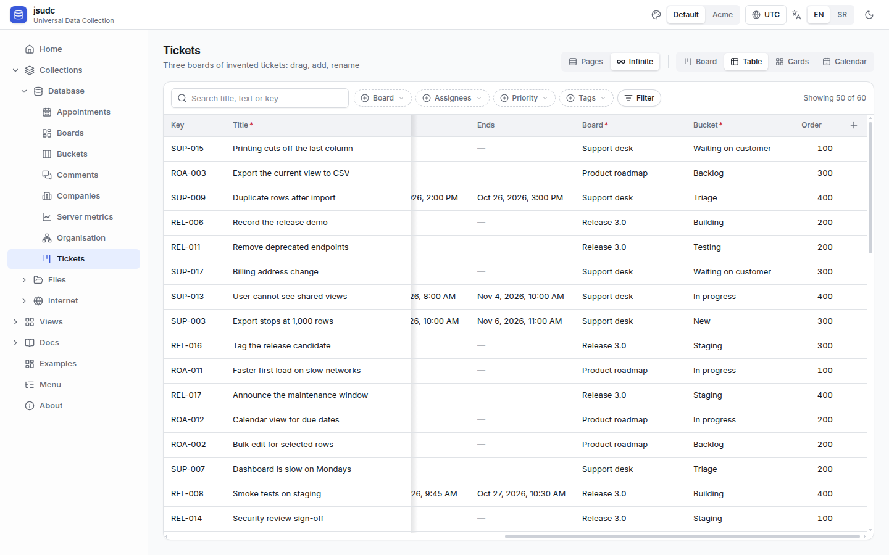

2. **Follow a lookup.** Click a board name in a row. It opens `/udc/boards`
   filtered to that one board (`?f=` is `id eq <board id>`; the filter pill
   shows the id, as written). Back takes you to the tickets.
3. **Filter by a lookup.** Open the **Board** chip: its options are the boards
   by name. Pick *Release 3.0*: the table narrows to its 20 tickets; the URL
   keeps the board's id (`?cf=`). The **Assignee** chip has a search box,
   because `org` has more than 50 rows: type `Zoran`, pick him, and only his
   tickets are left.

   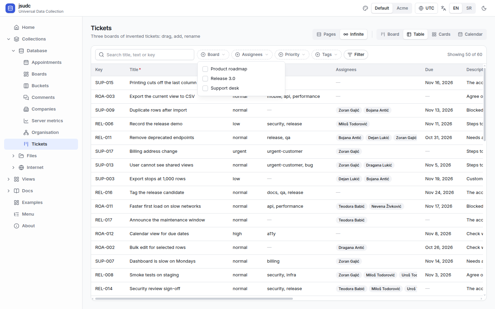

   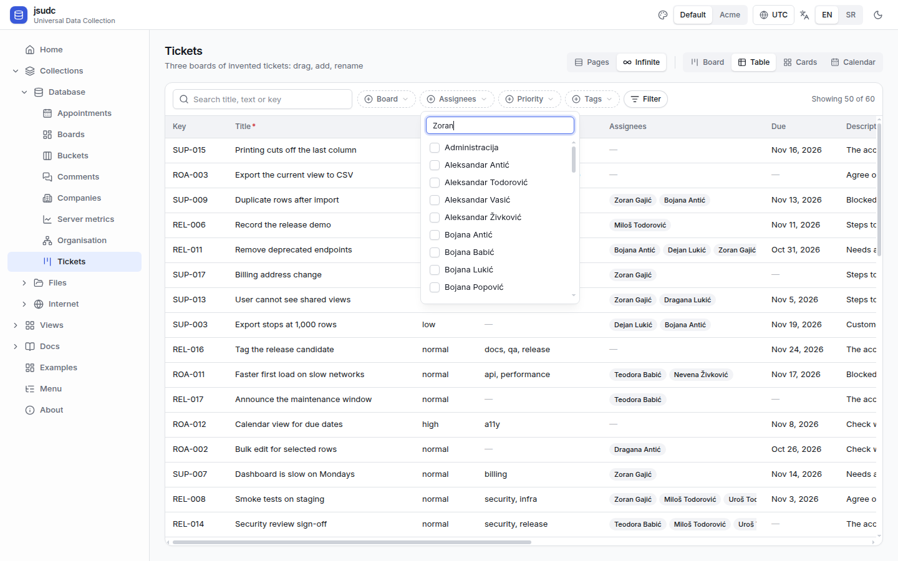

4. **Edit with the combobox.** Double-click an *Assignees* cell (a single
   click on a name follows the link; a double-click edits). The people already
   assigned are chips with an ×; type `Ma` to search `org`, click a name (or
   arrow to it and press Enter) to add it, click it again to take it off.
   Backspace on an empty search removes the last one. Enter on an empty search
   (or Tab, or a click outside) saves: the row stores the ids, the cell shows
   the names. Escape cancels.

   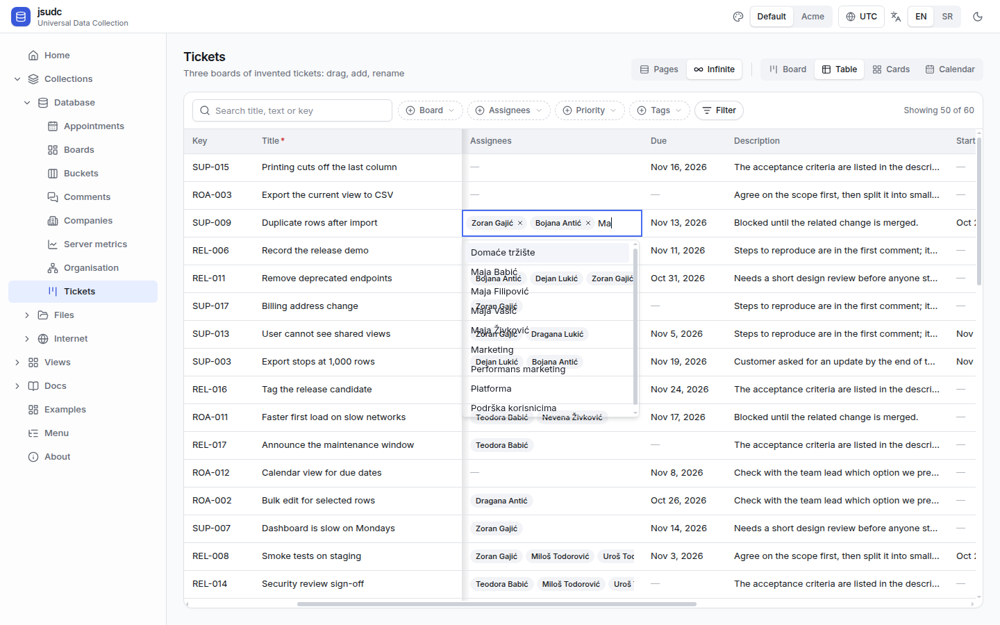

   Two things in this picture are known in 0.3.0. The list is drawn without a
   background, because `@jsudc/react`'s combobox uses a `popover` colour its
   theme does not define; that is a known issue of `@jsudc/react` 0.3.0. It
   also offers the units of `org` (*Marketing*, *Platforma*) as well as the
   people: a level-1 lookup has no filter on its target, so every row of `org`
   is a candidate.

5. **Drill down.** Open `/udc/boards`. The rows have a pointer cursor. Click
   *Release 3.0*: you land on `/udc/tickets` with the filter *Board equals
   Release 3.0* (the pill names the board, not its id), on the default
   renderer, the kanban. Its board select reads *Release 3.0* too and the
   columns are that board's buckets (*Planned*, *Building*, *Testing*,
   *Staging*, …), holding its 20 tickets. The link carries only the filter, no
   `?board=`: when there is none, the kanban (and the calendar) takes its board
   from an `eq` filter on its board field, so it lands on the board you clicked,
   not on the first one (*Product roadmap*). **Table** and **Cards** show the
   same 20. Cmd/Ctrl-click a row (or middle-click) opens the drill-down in a
   new tab; a click on a link or a control inside a row does not drill down.

   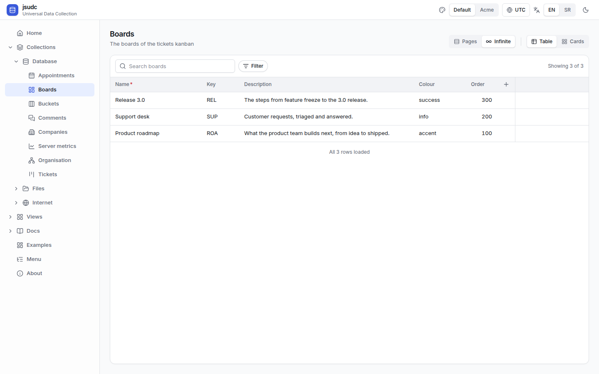

   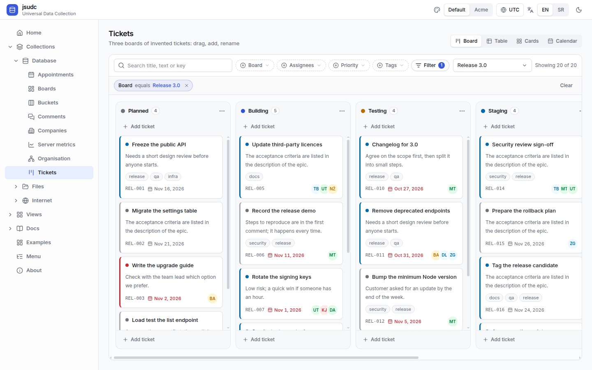

   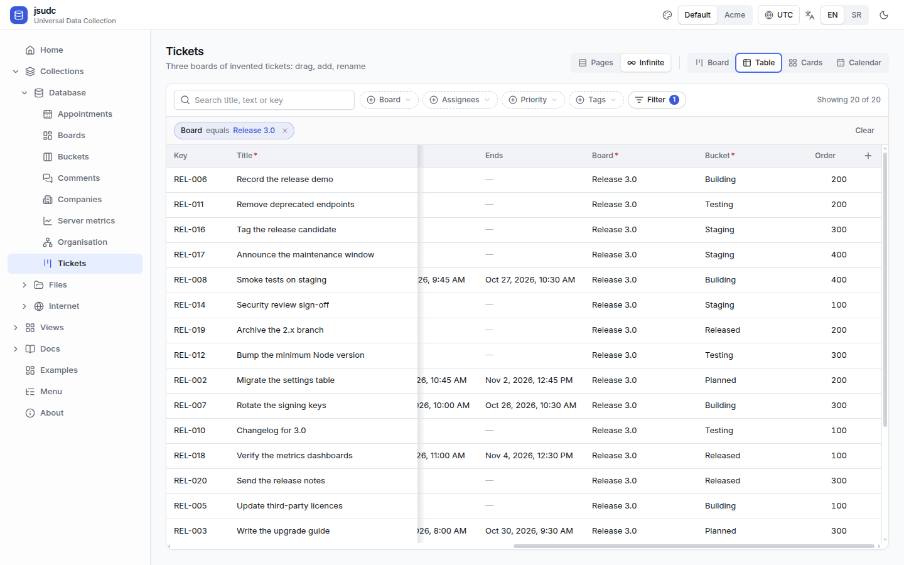

The server checks every lookup and `row_link` against the target's schema when
it starts: a lookup naming a field `boards` does not have stops the start with
one line saying which. A `lookup` filter accepts `eq neq in not_in is_null
is_not_null`, a `lookup_array` filter `in not_in is_null is_not_null`. The
design is in
[`docs/superpowers/specs/2026-11-11-jsudc-lookups-design.md`](superpowers/specs/2026-11-11-jsudc-lookups-design.md).

## The calendar: `appointments` and the time zone switch

`npm run seed` generates the appointments around the day it runs (six weeks
either side, Belgrade working hours). To show exactly the screens below, seed
with the day pinned: `SEED_TODAY=2026-10-27 npm run seed -- --reset`, then
open `http://localhost:<vite port>/udc/appointments?date=2026-10-27`.

1. **The work week.** The calendar opens on the work week (the view's
   `default_preset`), scrolled to 07:30, one colour per doctor. Overlapping
   appointments share the column in lanes; the grey bands are outside
   `business_hours` (8–20); a red line marks now. *Showing N of N* counts the
   appointments of the visible week: the calendar asked the server for just
   that window (`between` on `start`, from 00:00 Monday to 23:59:59.999 Friday
   in the active zone; see the `list` call in the network tab).
2. **Navigate.** Prev / Next / Today and Day · Work week · Week · Month. The
   window is `?preset=&date=` in the address bar. In Month, a day shows four
   chips and *+N more*; click it for the whole day, or click the day number to
   open that day.
3. **Move and resize.** Drag an appointment one hour down: it snaps to 15
   minutes and is saved at once (`mutate update {start, end}` with the row's
   version; the fields come from `start_field`/`end_field`). Drag it to another
   day column, or drag its bottom edge to make it longer. Escape during a drag
   puts it back. In Month, drag a chip to another day: same time, new day.
4. **Details.** Click an appointment: its time in the active zone, the doctor
   and patient, and room, status and notes editable in place. *Delete* asks
   once more. Click empty time to add one: type a title, Enter (the doctor is
   the one picked in the *Doctor* chip, else the first).
5. **Filter.** Pick *Ana Vuković* in the Doctor chip: one colour left on the
   grid. Search and chips combine with the window.
6. **The time zone.** The header has a zone switch next to the language and
   theme (it starts on the browser's zone). Find the 08:00 *Check-up · Aleksa
   Jović* on Tuesday 27th and switch the header to **America/New_York**: it
   moves to **3:00 AM** at once, without a reload. (On most dates of the year
   it would be 2:00; on 2026-10-27 Europe has left summer time and New York
   has not yet, so the gap is five hours.) **Asia/Tokyo** shows it at 4:00 PM;
   **UTC** at 7:00 AM. The days now run from midnight in that zone, so the
   next `list` call asks for a different window, ending in `-04:00`. The
   **Table** tab shows the same shifted times in the *Start* column. Reload:
   the zone is remembered (this browser, `localStorage`), and it is not part
   of the link. A drag made while New York is active writes New York's offset
   (`2026-10-27T04:00:00-04:00`); the server stores the instant, so Belgrade
   sees it at 09:00.
7. **Tickets.** `tickets` has a **Calendar** tab too: about 40% of the
   tickets have a slot in the current or next week, coloured by priority. The
   board select stays in the toolbar and `?board=` carries over from the
   board tab.

Everything the calendar does comes from `calendar_options` in each
`view.yaml`, typed by `CalendarOptionsSchema` in `udc-core`; the server
refuses to start if `start_field` / `end_field` are not `datetime` fields.

## The tree: `comments` and `org`

Two collections share one `tree` renderer, driven only by `tree_options` in
their `view.yaml` (typed by `TreeOptionsSchema` in `udc-core`; the server
refuses to start when a field it names is not in the schema, or when a lazy
tree has no `children_count_field`).

1. **A thread.** Open **Comments**: one discussion of 80 comments, read in
   one page and built in the browser (`lazy: false`), fully expanded
   (`default_depth: 99`). The toolbar counts *80 nodes*. Up / Down move
   between comments, Left closes one, Right opens it, Enter shows every
   field.
2. **Search.** Type *Beograd*: the matching words are marked, every comment
   on the way to a match opens and the rest of the thread closes
   (`on_search: highlight_and_expand`, `collapse_others`). Nothing went to the
   server: the whole thread is still loaded. Clear the search and the tree is
   back as you left it.
3. **Reply.** `⋮` on a comment → *Reply*, write, Enter. The reply appears
   under it (by "You"), with `parent_id`, `depth` one deeper and the next
   sparse `order`.
4. **Chips.** Pick an author in the *Author* chip: the filter runs on the
   server; a reply whose parent did not match is drawn as a root with a small
   muted arrow, so nothing disappears just because its parent was filtered.
5. **One level at a time.** Open **Organisation** (`lazy: true`): the company
   with its six departments; *1 of 134 nodes*. Open *Inženjering*: one more
   `list` with `parent_id eq <id>` brings its teams, with a spinner while it
   loads; the badge is the stored `children_count`. What you open is
   remembered (`udc:tree:org` in `localStorage`).
6. **Rename.** Double-click *Podaci*, type, Enter: saved with the row's
   version; reload, it stays.
7. **Move.** Drag *Platforma* onto *Prodaja*: it becomes Prodaja's last team.
   Drop it on the thin gap above a sibling instead to place it between two.
   One `tree.reparent` call moves it: the server writes `parent_id` and
   `order`, recomputes `depth` and `ancestor_ids` for the team and every
   person in it, and recounts both departments' `children_count` — in one
   transaction (badges: *Inženjering 3*, *Prodaja 4*). Try to drag
   *Inženjering* onto one of its own teams: the target is refused while you
   drag and nothing is sent (the server would refuse the cycle too).
8. **Filters.** *Kind = person* plus a search for *Vođa* lists the matching
   people as roots (their teams did not match); the **Table** tab shows the
   same rows flat.

## The map: `companies` on OpenStreetMap

The same 200 companies, placed: each has a `lat` / `lng` a few km from the
centre of its city (`backend/scripts/generate-companies.ts`). A database
seeded before this ticket has no coordinates (and schema revision 1 without
the two fields): run `npm run seed -- --reset` once. The `map` renderer is
driven only by `map_options` in `view.yaml` (typed by `MapOptionsSchema` in
`udc-core`; a view that lists `map` without `map_options`, or names a field
the schema lacks, stops the server at start).

1. **Open the map.** On **Companies** pick the **Map** tab (`?tab=map`). One
   circle per company over Serbia, sized by head count
   (`radius_min + employees * radius_scale`, capped at `radius_max`),
   inactive companies in grey (the view's `row_color`, the same rule that
   dims them in the table). The toolbar reads *200 on map of 200*. The tiles
   come from `tile.openstreetmap.org`, straight from the browser.
2. **Hover and click.** A circle gets an outline on hover; click one and its
   popup shows `popup_fields` (name, city, industry, employees) formatted as
   the table formats them, and the circle stays highlighted until the popup
   closes.
3. **Regions.** *Serbia* is pressed: it is the view the map opened on.
   *Vojvodina* and *South* fly there; *Fit all* frames every company, and no
   region button is pressed any more (the same happens when you pan by hand).
4. **Chips move the markers.** *City = Niš*: only the Niš companies stay,
   *N on map of N*. Add *Employees ≥ 500* or search a name: the circles
   follow, as the table rows would. The map keeps where you put it.
5. **Same filter, any tab.** Reload: still the map, still Niš. Switch to
   **Table**: the same rows, the `lat` / `lng` columns at the end. Search for
   something that does not exist: the table's empty state, over the map.
6. **Dark.** Switch the theme: the tiles are inverted by a CSS filter on the
   tile pane, the circles take the dark theme's colours.

## Files and the internet: `files`, `quakes`, `repos`

Not every collection is a table. A `source.yaml` next to `view.yaml` says
where the rows come from (`backend/collections/<name>/source.yaml`; without
one, Postgres). The sidebar groups the collections that way: **Database**,
**Files**, **Internet**. Each of the three new ones has a **Doc** tab, its
`README.md` (or `README.sr.md` in Serbian).

1. **Files.** Open **Files**: the entries of `backend/collections/files/sample/`,
   folders first, sizes as `167 B` / `29.6 KB`, read-only (no inline edit,
   no column menus, no `+`). Click `docs`, then `archive`: the address bar's
   `?f=` holds `path eq docs/archive`, the breadcrumb above the table is that
   condition, and a reload (or the link sent to someone) opens the same
   folder. `..` and the breadcrumb go back up. *Ext = csv* and the search box
   work inside the open folder. Click `notes.md` or `logo.png`: a preview
   (`GET /udc/files/blob`, text and images up to 256 KB). Point it elsewhere
   with `UDC_FILES_ROOT=/some/folder npm run dev`.
2. **Earthquakes.** Opens on the **map**: every M4.5+ earthquake of the last
   month, live from USGS, sized by magnitude and coloured by class (the same
   `row_color` tints the table). *Europe* / *Pacific* fly there. *Mag* is a
   range chip (6 – 8 leaves the strong ones), *Alert* a select. The toolbar
   reads *updated N s ago*: the server keeps the feed for 60 s and the page
   polls every minute (`refresh_interval_ms`), without moving the map. Switch
   to **Table**: the same filter, alert and status as coloured badges.
3. **Repositories.** The public repositories of `digital-cube`, from the
   GitHub API, as cards with the owner's avatar, the language and the topics.
   Without `UDC_GITHUB_TOKEN` GitHub allows 60 calls an hour; the five-minute
   cache keeps this collection at 12 at most.
4. **Offline.** If an upstream fails after a good fetch, the last copy is
   served with a **stale** pill; if it never answered, the view shows the
   error. `UDC_HTTP_SOURCES=off npm run dev` leaves the Internet group out;
   `UDC_HTTP_FIXTURES=backend/test/fixtures/http` serves recorded answers
   (what `npm run e2e` does, so Cypress never needs the network).

## Charts: `metrics`, the `repos` pie, the `quakes` bars

The **chart** tab draws whatever `chart_options` in `view.yaml` says (typed by
`ChartOptionsSchema` in `udc-core`; the server refuses to start when a series
is not a number field or a field is missing). `metrics` is a dedicated
dataset: three servers sampled every 15 minutes for the 30 days before
`npm run seed` ran (generated at seed time, ~8,600 rows). The short windows
end at the seed, so reseed (`npm run seed -- --reset`) before showing it on
another day.

1. **The 24h window.** Open **Server metrics**: CPU and memory as lines on the
   left axis (0–80 %, round ticks), the load average on the right axis framed
   on its own numbers. Without a host chip each point is the mean of the three
   hosts at that quarter hour; the spike three hours before the end is
   `web-1`'s incident. The toolbar reads *N points in window of 8,640*: the
   chart asked the server only for its window — in the network tab the
   `list` call carries `{"field":"ts","op":"between","value":[…]}` from 24
   hours ago to now, written with the header zone's offset, ANDed with the
   chips and the filter tree.
2. **Presets.** 1h · 6h · 24h · 7d sit in the toolbar row; the choice is
   `?win=7d` in the address bar. 7d is the last seven *calendar days* in the
   active zone (midnight six days ago to the end of today): the axis turns to
   days, the weekend dips show, and the rows are averaged into half hours so
   the line stays readable. *Custom* opens a from / to pair (`?from=&to=`,
   wall times read in the header's zone).
3. **Hover and legend.** Hover the plot: a tooltip with the time and each
   series formatted as the table formats them (`27.10.2026 18:30`, `50.4`).
   Click *Memory %* in the legend to hide it; the left axis re-frames on what
   is left.
4. **One host.** Pick *db-1* in the **Host** chip: the lines are now one
   server's samples (the database's memory sits nearly flat, 71–74 %), and the
   tooltip shows that row's values exactly.
5. **The time zone and the window.** With 6h picked, switch the header zone
   from **Europe/Belgrade** to **Asia/Tokyo**. The axis relabels at once
   (at noon in Belgrade, 06:00–12:00 becomes 14:00–20:00), and the next `list` call's `between`
   reads `…T14:00:00.000+09:00` – `…T20:00:00.000+09:00`: the hour presets
   are the same instants in every zone, written in its offset. Pick **7d**:
   now the zone moves the instants themselves — Tokyo's week starts at
   `2026-10-21T00:00:00.000+09:00`, seven hours before Belgrade's
   `…+02:00` (dates as with `SEED_TODAY=2026-10-27`). Reload: the zone
   (`localStorage`) and the preset (the URL) are both kept.
6. **The same window in the table.** Switch to **Table** with a preset picked:
   the table asks for the same `between` and shows those rows (the window
   control stays in the toolbar, with a × to drop it and see all 8,640).
7. **Repositories as a pie.** Open **Repositories** → **Chart**: stars per
   repository, the ten largest as slices with their percentage and the rest
   folded into **Other** (`max_slices: 10`). The recorded fixture has star
   counts set on sixteen repositories for this; the live GitHub account has
   only three starred ones, so live it is a three-slice pie.
8. **Earthquakes as bars.** **Earthquakes** → **Chart**: one bar per quake
   over the last 7 days, height = magnitude, the axis framed on the
   magnitudes (`baseline: data`) rather than on zero. 24h · 7d · 30d move the
   window; the page polls every minute as the map does.

Light and dark use the categorical palette `--chart-1 … --chart-8` in
`index.css`, a validated order with its own dark steps. Cypress
(`frontend/cypress/e2e/chart.cy.ts`) freezes the browser clock at the
seed's noon, so every `between` above is checked to the millisecond.

## Flights: aircraft from OpenSky, with a history the API does not have

`flights` (`backend/collections/flights/`) is every aircraft the OpenSky
Network sees over Serbia and its neighbours — a 5° × 5° box, the largest that
costs one credit a call — called **anonymously** (no account, no key).

1. **The map.** **Views ▸ Flights map** (`/udc/flights?tab=map`): an
   aeroplane per aircraft (`icon: airplane`), turned along its track
   (`rotate_field: heading`, CSS `rotate`) and coloured by altitude through
   the view's `row_color` — blue at cruise, green climbing or descending,
   amber on approach, grey on the ground. Hover one: its outline darkens and
   its trail turns from grey to its own colour. *Balkans*, *Belgrade* and
   *Adriatic* fly to a region.
2. **The trails grow while the server runs.** OpenSky only answers *where is
   everything now*. The source's `history` block keeps, per ICAO24 address,
   the last 60 values of `baro_alt`, `lat` and `lng` across calls and serves
   them as `baro_alt_history`, `lat_history`, `lng_history` (the server adds
   them to the schema; `schema.json` does not list them). Right after a start
   there are no trails; after the second upstream call every aircraft still
   in the box has two points, and so on. Up to 300 aircraft every trail is
   drawn; above that only the hovered and the selected one.
3. **A poll does not move you.** The page polls every 30 s; the markers are
   kept by id and move in place, the open popup follows its aircraft, the
   viewport stays where you put it.
4. **The budget.** Hover *updated … ago*: *Upstream access: anonymous*,
   *Server cache: 4 min*. However many tabs poll, OpenSky is called at most
   every 4 minutes (360 calls of the 400 a day it allows an IP); the backend
   log has a line per call (`flights: GET … → 200 (anonymous)`). With
   `UDC_OPENSKY_CLIENT_ID` and `UDC_OPENSKY_CLIENT_SECRET` set (an OpenSky API
   client) the source fetches an OAuth2 token, refreshes it at 90 % of its
   life, and the cache drops to 15 s; the tooltip then says *OAuth2 client*.
5. **Chips.** *On ground = No* drops the taxiing ones, *Baro alt* 9 000 –
   13 000 leaves the cruise traffic, the search box matches callsign, ICAO24
   and country.
6. **Table and cards.** **Table**: `baro_alt_history` as a sparkline (framed
   on its own min and max, the latest value a dot, the range in its tooltip),
   the track as an arrow (`heading_glyph`, degrees on hover), altitudes and
   speeds with `number_format` `precision` and `suffix` (`10,973 m`,
   `246 m/s`). **Cards**: the altitude large (`card_options.metric`) and its
   sparkline under the details.
7. **The row is an array.** **Doc** explains the positional state vector
   (`id_field: "[0]"`, `lng: "[5]"`, `lat: "[6]"` — lng before lat), Unix
   seconds (`epoch_seconds`) and the padded callsign. Offline,
   `UDC_HTTP_FIXTURES=backend/test/fixtures/http` serves two recorded answers,
   `flights.1.json` then `flights.2.json`, so the trails have two points after
   the second call (`UDC_FLIGHTS_CACHE_TTL_MS=1000` shortens the wait; that is
   what `npm run e2e` does).

## The menu: the sidebar is a collection

The sidebar on the left is not hard-coded: it is the `menu` collection
(source `yaml_menu`), whose rows come from one checked-in file,
`backend/collections/menu/data/menu.yaml`. The frontend lists every row once,
builds the tree and draws it as chrome (`frontend/src/shell/MenuTree.tsx`).

1. **The shape.** Six roots: **Home**, **Collections**, **Views**, **Docs**,
   **Menu**, **About**, each with a lucide icon named in the YAML
   (`icon: lucide:layout-grid`). Open **Collections**: **Database**, **Files**
   and **Internet** list the collections the server serves — nobody wrote
   them. Each of the three nodes says `children: "udc:collections?group=…"`
   and the backend splices in one leaf per collection of that group from its
   own registry on every read.
2. **The active leaf.** Click **Views ▸ Tickets board**: `/udc/tickets?tab=kanban`
   opens and that leaf is lit. Expand **Collections ▸ Database**: **Tickets**
   there points at the same path without a tab, so it stays dark — a leaf
   naming the tab wins. Switch the data view to **Table**: now the Views leaf
   no longer matches and the collection's leaf lights up. Reload: what you
   had open stays open (`localStorage`, `udc:menu:expanded`), and the way to
   the active leaf is always opened.
3. **Languages.** Switch to **SR**: every label is a `translation_key`
   (`MENU_VIEWS` → `t("MENU", "VIEWS")` → *Prikazi*); the collection leaves
   use `COLLECTIONS_<NAME>`, which the old sidebar's names already translate.
4. **The same rows as data.** Click **Menu**: `/udc/menu` opens on the
   **Tree** tab with the same nodes. **Table** shows the columns the tree is
   built from — `parent_id`, `order`, `depth`, `ancestor_ids`,
   `children_count` — and `is_dynamic` ticked (and the row tinted) on every
   row the registry added. Search `view` finds the Views entries by key,
   code or url: the whole `ArraySource` filter set works on a file.
5. **The file.** **Source** shows `menu/data/menu.yaml` as written, with its
   modification time. Edit the file — move **About** above **Menu**, rename a
   `translation_key` — and reload the page: the sidebar has changed, and the
   ids of moved nodes have not (an id is the sha1 of the code path), so what
   was expanded stays expanded. Break the YAML and reload: the sidebar keeps
   the last good version, and the Source tab names the parse error.
6. **About.** The last root, `/about`, renders the README's first section
   (in Serbian from the translations).

A deployment without a `menu` collection (or with `VITE_MENU_COLLECTION`
naming none) gets the previous sidebar, the collections grouped by
Database / Files / Internet.

## The mailbox: `/mail`, context and scope, `postgres_table`, `onMutate`, an embedded view

A small mail client, written in the example on `@jsudc/*` 0.4.0 and extended on 0.5.0 (see [What 0.5.0 adds](#what-050-adds-selection-row-actions-host-actions-live-updates-source-search-a-long-list)): three demo
users with their own folders and messages, a folder list and a reading pane
of the example's own, and the message list between them a `UdcDataView`.
Each part below shows one thing 0.4.0 adds:

| part | where | what it demonstrates |
|---|---|---|
| the user switcher in the header | `frontend/src/mail/demoUser.ts`, `UserSwitch.tsx` | `UdcClient`'s `headers` as a function, called before every request (`x-demo-user`); `createUdcQueryClient({ onUnauthenticated })` |
| `demoContext`, `demoRowScope` | `backend/src/mail/context.ts`, `backend/src/main.ts` | the plugin's `context` and the dispatcher's `rowScope`: `owner = <the user>` on the three mailbox collections, hidden from `describe`; no user → `forbidden`, `details.reason: "unauthenticated"` |
| `mail_folders`, `mail_messages`, `mail_audit` | migration `backend/drizzle/0006_mail_tables.sql`, `backend/src/mail/sources.ts` | `postgres_table`: typed columns and UUID ids; `unread_count` / `message_count` computed by a subquery; `folder_name` from a join (read-only); `total_count: false` on the messages |
| the audit trail in the reading pane | `auditMessageChange` in `backend/src/mail/sources.ts` | `onMutate`: one `mail_audit` row per change of a message, after the statement and before COMMIT, in the same transaction |
| the message list | `frontend/src/mail/MailPage.tsx` | embedding: the open folder as `filter`, `chrome="embedded"`, `pagingMode="infinite"`, a button in `toolbarStart`, `urlPrefix="list."` |
| the reading pane following the list | `MailPage.tsx` | row activation: `activeRowId` (`?m=`), `onActiveRowChange`, `onRowActivate`; `j` / `k`, the arrows, Home / End, Enter |
| the blue dot | `frontend/src/mail/cells.tsx`, `mail_messages/view.yaml` | a custom cell: `createCellRegistry`, `UdcProvider cells`, `render: unread_dot` |

`npm run seed -- --reset` (after `npm run db:migrate -w @jsudc/backend`, for
`0006`) writes for each of Ana, Marko and Jelena six folders (Inbox, Sent,
Drafts, Archive, Trash and one of their own: *Projects*, *Travel*,
*Receipts*) and 300 messages over the 60 days before the seed day, the newest
an unread *Welcome to the jsudc mailbox, <name>*. With `SEED_TODAY=2026-10-27`
the rows are the ones in the pictures. Open `http://localhost:<vite port>/mail`
(or **Views → Mailbox** in the menu).

1. **One user's mailbox.** The header says *Ana*. The folder list is hers,
   each folder with its unread count (computed on the server from the
   messages); the Inbox is open, newest first: the view's `default_sort`
   (0.6.0), so the first request already carries it and the **Received**
   header shows it, while the URL stays clean (a sort you click goes there,
   as `?list.sort=`, the view's own parameter under its prefix). The dot column is the
   example's `unread_dot` cell. The list has no title, tabs or frame: it is a
   pane. Its toolbar starts with the example's own **Unread only** button.

   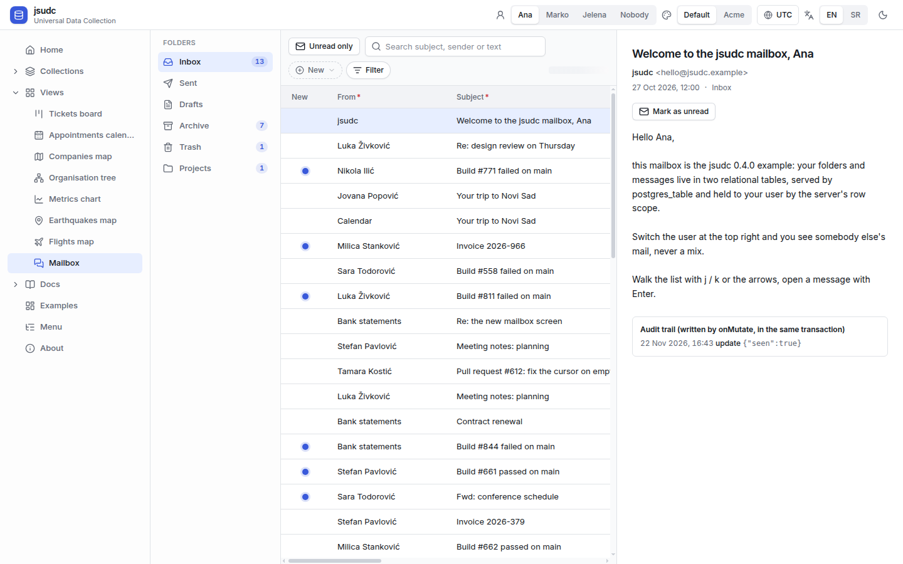

2. **The keys.** Click a row: the reading pane opens it (`?m=<id>`) and, if
   it was unread, marks it seen. Now press `j` (or ArrowDown): the next row
   is active and the pane follows without Enter; `k` goes back, Home / End
   jump, Enter opens. Type in the search box and the keys are the box's, not
   the list's. Change folders on the left: the folder is the view's host
   filter (not a chip, not in "Clear filters").

   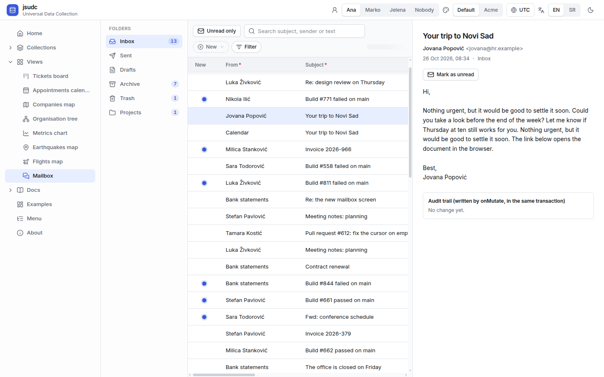

3. **Unread only.** The toolbar button ANDs `seen = false` into the host
   filter (`?unread=1`). The list shows only dots; open one and it leaves the
   list on the next read, the pane keeps it.

   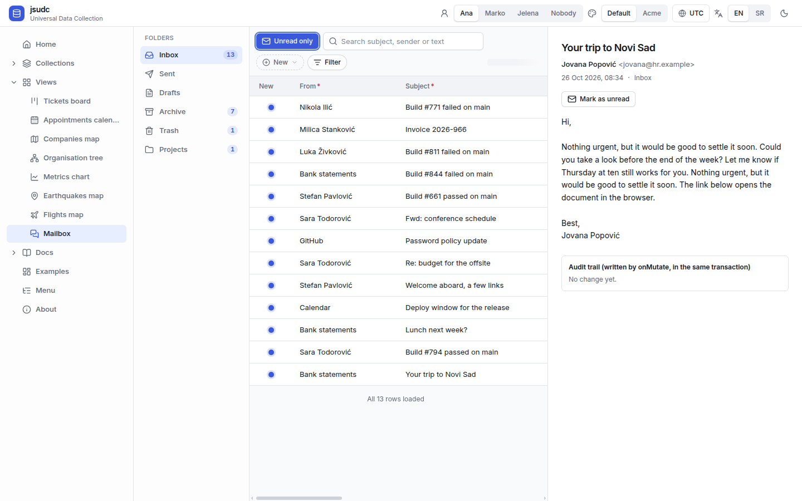

4. **`onMutate`.** Under every message the pane lists its audit trail. Press
   **Mark as unread**, then **Mark as read**: each press is one `mutate` (with
   `expected_version`), and each wrote one `mail_audit` row in the same
   transaction. A refused change writes nothing: another user's message, a
   stale version, a read-only field (`folder_name`, `received_at`) — the
   backend tests check all three (`backend/test/mail.test.ts`). The folder's
   unread count follows.

   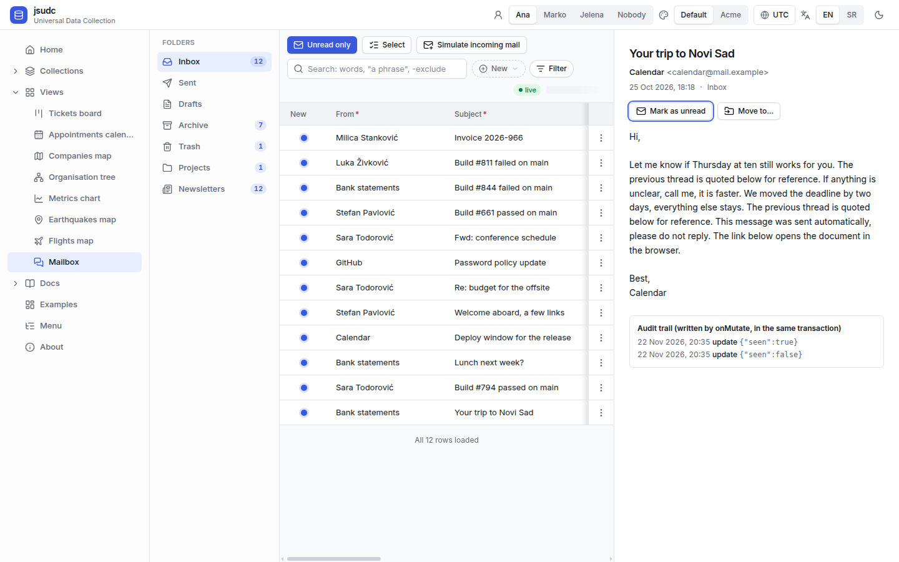

5. **The scope.** Copy the address of one of Marko's messages (switch to
   *Marko*, open his welcome message, copy the URL), switch back to *Ana* and
   open it: the pane says *No such message in this mailbox*. The server
   answered `not_found`, exactly as for an id that does not exist; it does
   not say the message is someone else's. Switch to *Marko* again: his
   folders (*Travel*, not *Projects*), his rows, and the same link opens. The
   switch resets the query cache: nothing cached for Ana is shown to Marko.

   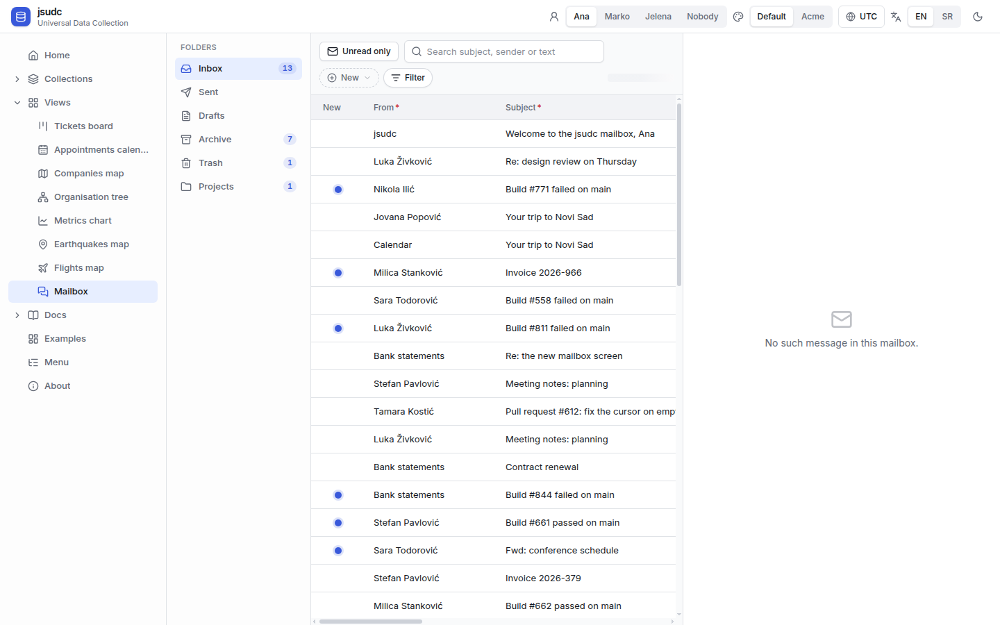

   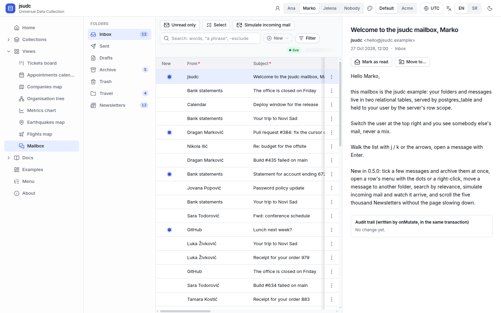

6. **Nobody.** Pick *Nobody*: the client sends no `x-demo-user`, the server
   refuses the mailbox with `forbidden`, `details.reason: "unauthenticated"`,
   the view shows *You are signed out* (no Retry) and `onUnauthenticated`
   colours the switcher's icon. `/udc/companies` still works: only the
   mailbox collections need a user.

   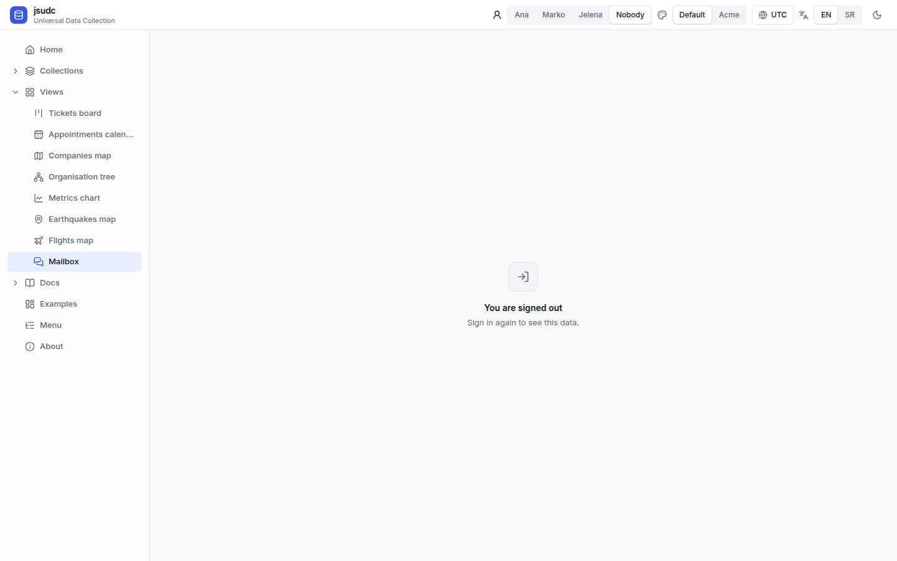

7. **The same rows as data.** `/udc/mail_messages` (Collections → Database,
   or Docs → Mail messages for its README) is the full view of the same
   collection for the user in the header: every column, both tabs, the
   *Infinite* paging. There is no `owner` column (the scope's field is
   hidden), nor a column for the address, preview, folder id or text (the
   view marks them `hidden: true`; they are still in the rows and the filter
   builder), and the folder name comes from the join.

   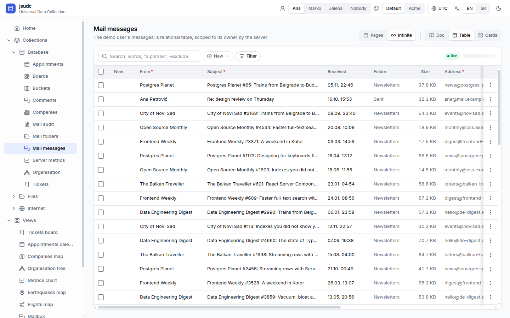

Over HTTP, the scope is plain to see:

```sh
curl -s localhost:5100/udc/list -H 'content-type: application/json' \
  -d '{"collection":"mail_messages","page":{"limit":1}}'
# {"kind":"udc.list.err",…,"payload":{"code":"forbidden","message":"pick a demo user to open the mailbox","details":{"reason":"unauthenticated"}}}
curl -s localhost:5100/udc/list -H 'content-type: application/json' -H 'x-demo-user: ana' \
  -d '{"collection":"mail_folders"}'
# Ana's six folders, unread_count and message_count computed, no owner field
```

Three things to know in 0.4.0:

- **The count.** With `total_count: false` the server answers `total: null`.
  Up to `@jsudc/react` 0.5.0 the toolbar's count stayed a grey placeholder
  instead of saying how many rows are loaded (visible top right in the
  pictures, beside *live*; reported as TCKXTDJURQ). Since 0.5.1 it says what
  is loaded: *Showing 50+* while a full page says there may be more,
  *Showing N* once the folder is all loaded, here and on
  `/udc/mail_messages` (`frontend/cypress/e2e/mail-051.cy.ts`).
- **Every field is a column, unless the view hides it.** `describe` adds a
  column for each schema field a view does not list. Up to 0.5.x a view could
  not leave one out, so the message list's `view.yaml` listed the fields the
  reading pane shows instead (address, preview, folder id, text) last, as
  columns. Since 0.6.0 they are `{field: …, hidden: true}`: no column, and
  `describe` adds no default one for them, but they stay in the schema and in
  every row. Search still matches `sender_email` and `preview`, the reading
  pane still reads them, and the row action *Archive* still checks
  `folder_name`. A field added later would still become a column; a view that
  wants only its listed columns says `columns_mode: listed`.
- **The scoped stylesheet.** `/mail` does not import
  `@jsudc/react/styles.scoped.css`: this app's pages are the library's own and
  load the global `styles.css`, and the library asks for one of the two. A
  host whose own pages embed the list imports the scoped sheet instead; the
  code under `src/mail/` is the same either way.

### What 0.5.0 adds: selection, row actions, host actions, live updates, source search, a long list

The same screen on `@jsudc/*` 0.5.0. Nothing above changed. Each new part is
here the way a host such as a mail client would use it:

| part | where | what it demonstrates |
|---|---|---|
| the toolbar's **Select**, the checkboxes and the bulk bar | `mail_messages/view.yaml` (`multiselect`, `bulk_actions`), `MailPage.tsx` (`selectable`, `actions`) | selection (a range on shift-click, Space on the active row, the page); *Mark read* / *Mark unread* by `set` (a `mutate_many` update, no code); *Delete* built in (a confirmation, then `mutate_many` delete); *Archive* by a host handler (`actions={{ archive }}`) |
| "Select all that match" | the same, on a folder | the selection by filter minus the unticked rows; `mail_messages` has `total_count: false`, so the offer and the bar carry no number and the result says what the server changed (`updated`) |
| the dots at the end of each row | `row_action_defs`, `row_actions_display: menu` | row actions in a menu (also right-click, Shift+F10 or `.`), each where its `when` holds: no *Mark read* on a read message, no *Archive* in the Archive |
| **Move to…** in the reading pane, and *Archive* | `shared/src/mail-actions.ts`, `backend/src/mail/actions.ts`, `MailPage.tsx` | a host action typed end to end: `defineHostAction` once in `@jsudc/shared`, `Dispatcher.register(moveToFolder, handler)` with the request context, `useUdcAction(moveToFolder)` in the browser. The handler reads the target folder under the caller's scope (another user's folder is `not_found`) and moves with one `mutate_many`, so the row scope, the audit and the feed all apply |
| **Simulate incoming mail** and the *live* badge | `simulateIncoming` in the same files, `createChangeFeed()` in `backend/src/main.ts`, `DemoUserFeed` in `App.tsx` | the change feed: `UdcProvider changes`; a host's own write announced with `changes.notify("mail_messages", { op: "insert", ids, ctx })`, which only streams in that user's scope hear; `useUdcChanges` refreshes the folder counts, which the feed cannot know are derived from the messages |
| the search box | migration `0007_mail_search.sql`, `MAIL_SEARCH` in `backend/src/mail/sources.ts` | search answered by the source: a generated `tsvector` (subject A, sender B, text C; `english` stemming) with a GIN index, the `postgres_table` `search` option (`match` and `rank`), `capabilities.search: "source"`; the box sends `search`, best match first |
| *Newsletters* | `generateNewsletters` in `backend/scripts/generate-mail.ts`, `VIRTUALIZE` in `MailPage.tsx` | a long list: 5,000 messages per user, infinite paging, `virtualize={{ enabled: true, overscan: 20 }}` |

After pulling: `npm run db:migrate -w @jsudc/backend` (for `0007`), then
`npm run seed`. *Newsletters* is added for every user who has none, even
without `--reset`, so a mailbox seeded by 0.4.0 keeps its messages and gains
the folder.

1. **Select and archive.** In Ana's Inbox press **Select** (`?select=1`): a
   checkbox column appears. Tick three messages; the bar shows *3 selected*,
   **Mark read**, **Mark unread**, **Archive** and **Delete**. Press
   **Archive**: one `POST /udc/mail.move_to_folder` with the three ids, and
   they leave the Inbox for the Archive (its unread count follows). Every
   moved message has an audit row: the move is a `mutate_many` with `onMutate`,
   one transaction, all or nothing.

   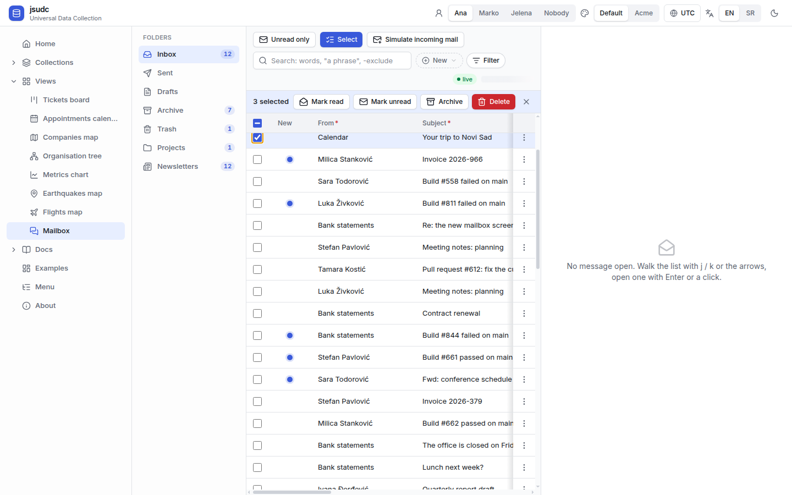

2. **Select all that match.** Open **Archive** (60 messages, 50 per page),
   press **Select**, tick the header's checkbox: the bar offers *Select all
   that match*, with no number, because the folder has no total. Take it: *All
   matching rows are selected*. **Mark unread** now sends `mutate_many` with
   the folder's filter, not ids, and the server answers how many it changed.

   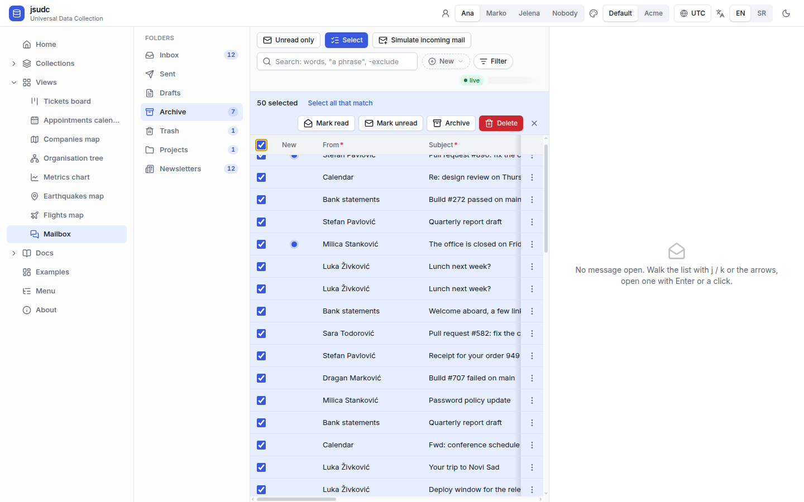

   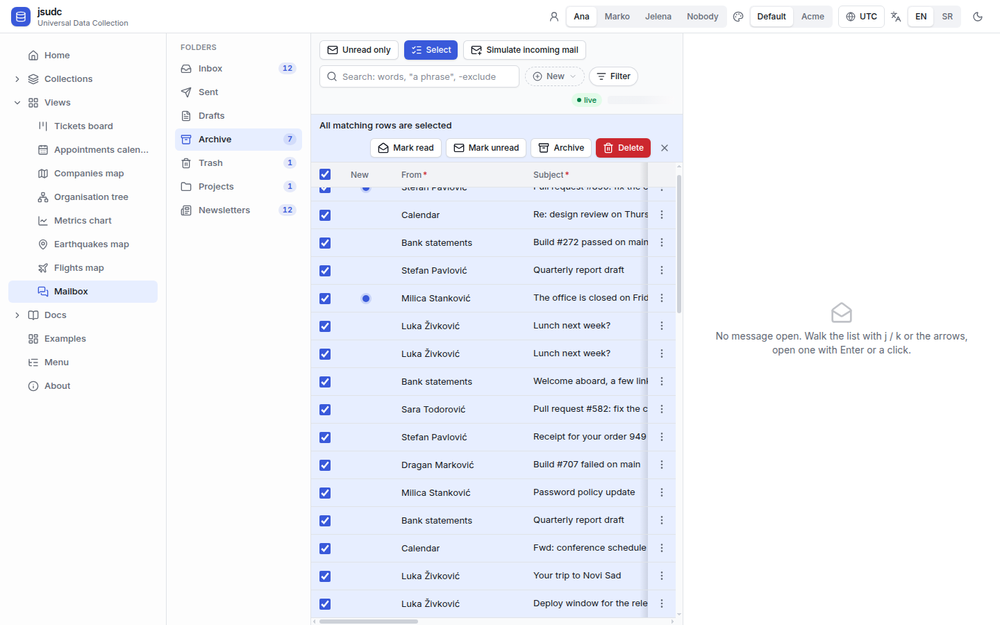

3. **A row's menu.** Without selecting anything, press the dots at the end of
   an unread message (or right-click it, or Shift+F10 / `.` on the active
   row): *Mark read*, *Archive*, *Delete*. On a read message the menu offers
   *Mark unread* instead; in the Archive there is no *Archive*. *Mark read*
   shows the message read at once and puts it back if the server refuses.

   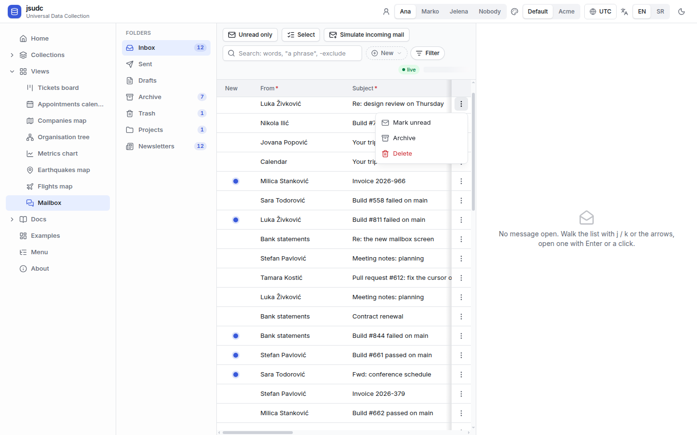

4. **Move to folder.** Open a message and press **Move to…** in the reading
   pane. The menu lists the user's other folders; pick one. The answer is
   typed `{ moved, failed }`. Over HTTP, another user's folder is
   `not_found` and another user's message is in `failed`:

   ```sh
   curl -s localhost:5100/udc/mail.move_to_folder -H 'content-type: application/json' -H 'x-demo-user: ana' \
     -d '{"folder_id":"<a folder id of Marko>","ids":["<a message id of Ana>"]}'
   # {"kind":"udc.mail.move_to_folder.err",…,"payload":{"code":"not_found",…}}
   ```

   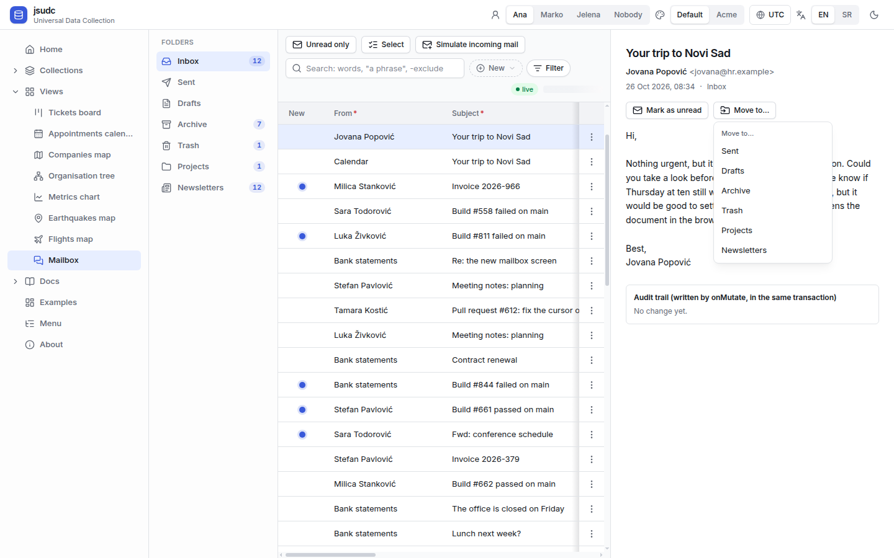

5. **Incoming mail, live.** The list's toolbar shows *live*: the stream is
   open. Press **Simulate incoming mail**: the backend writes a message into
   Ana's Inbox outside jsudc and tells the feed. The new message appears at
   the top, unread, and the Inbox count goes up, without a reload. Now open a
   second browser (or a private window) as **Marko** on `/mail` and simulate
   mail for Ana again: Marko's screen does not move. His stream asked for the
   same collection, but the server tests each change against each stream's
   row scope (`owner = marko`) and sends him nothing. Events carry ids only,
   never rows: the client refetches under its own scope.

   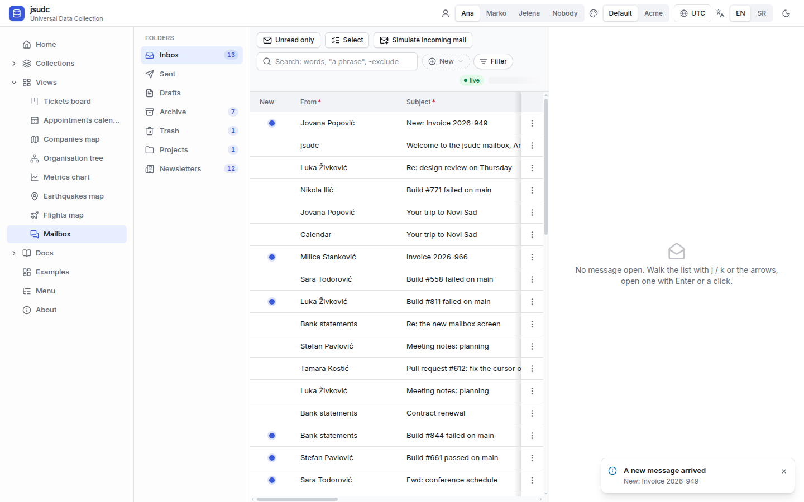

6. **Search by rank.** Type `invoices` in the search box: the request carries
   `search: "invoices"` (no `contains` filters) and no sort, so Postgres
   answers best match first (`ts_rank`); stemming finds *Invoice*. The
   view's newest-first `default_sort` steps aside while a search is typed
   (the data view does that itself for a source search) and comes back when
   the box is cleared; a column you sort by is kept. Web-search syntax
   works: `"design review"`, `build -passed`.

   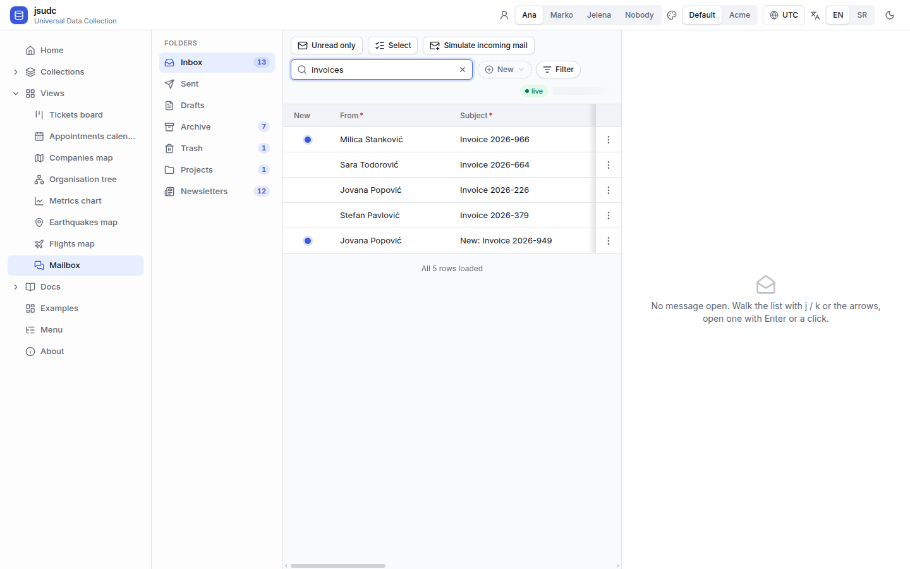

7. **A long list.** Open **Newsletters** and scroll, or hold `j`: pages of 50
   arrive as you near the end, and however many are loaded the table keeps a
   few dozen rows in the page (spacer rows stand for the rest). The
   scrollbar, the sticky header and the keys behave as if every row were
   there; `aria-rowcount` is the loaded count.

   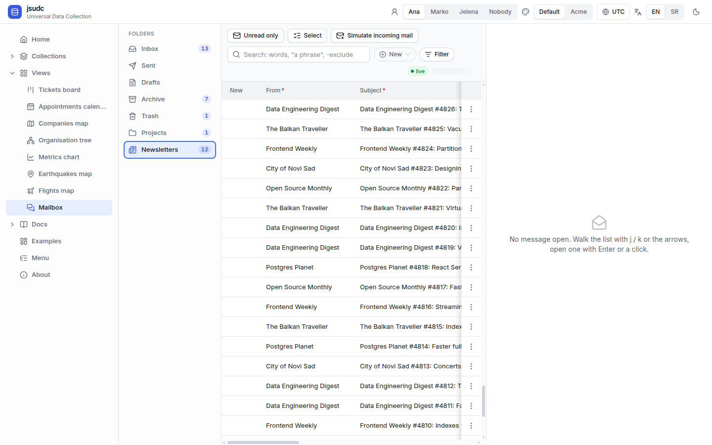

**One process or several.** The stage runs one backend process, so
`createChangeFeed()` uses the default in-process bus. A host with several
processes behind a load balancer gives every one the same bus, so a write
through one reaches the streams of the others:

```ts
import { createChangeFeed, createPostgresChangeBus } from "@jsudc/server";

const changes = createChangeFeed({
  bus: createPostgresChangeBus({ connectionString: process.env.DATABASE_URL!, pool: handle.pool }),
});
```

`PostgresChangeBus` keeps one `LISTEN` connection per process (reopened with
backoff) and sends with `NOTIFY` on `jsudc_changes`; Redis or NATS is a
`ChangeBus` of your own. Whatever sits in front must not buffer the stream:
nginx `proxy_buffering off`, a read timeout above the 15 s heartbeat, HTTP/1.1
upstream (the route sends `X-Accel-Buffering: no` itself).
`deploy/nginx/examples.jsudc.dev.conf` has that block for `/udc/changes`. The
stage vhost sends everything to Vite, which streams it through.

Things to know in 0.5.0:

- **Select is a switch here.** With selection on, 0.5.0 gives
  `aria-selected` its multi-select meaning (*this row is selected*) and marks
  the active row `aria-current` instead. The example turns selection on with
  the toolbar's **Select** (`selectable`) rather than always: off, the list is
  exactly 0.4.0's, the active row is `aria-selected`, and the 0.4.0 keyboard
  walk (step 2 above, `mail.cy.ts`) is unchanged. A mail client that always
  shows checkboxes leaves `selectable` out; the view's `multiselect` turns it on.
- **A feed per user.** The server fixes a stream's row scope when it opens,
  and the feed does not reopen when only the answer of `UdcClient`'s
  `headers` function changes. The example therefore keys the provider by the
  demo user (`<UdcProvider key={user} changes>`), which remounts the screen on
  a switch. Reported as TCKWEPXYF9 (a way to reopen the stream without
  remounting).
- **Derived counts.** The feed tells a client which collection changed. The
  folders' unread counts are computed from the messages, so the example
  listens to `mail_messages` with `useUdcChanges` and refetches `mail_folders`
  itself; its host actions also `notify` `mail_folders` for other clients.
- **Search and "all that match".** While a source search is typed, the bar
  offers no "Select all that match": `mutate_many` by filter cannot carry the
  search text, so only the loaded rows can be selected.

## What is behind it

- Three libraries and an example. `@jsudc/core` ([jsudc-core](https://github.com/digital-cube/jsudc-core)) holds the
  Zod schemas the server validates with and the browser types against;
  `@jsudc/server` and `@jsudc/react` are the server machinery and the data view.
  What you are looking at is the example: `backend/` (the collections, their
  tables, migrations and generators) and `frontend/` (the shell and its strings)
  depend on the three from npmjs.org (all `^0.6.0`) and import their built
  `dist`, as an outside project would.
- One endpoint, `POST /udc/:action`, serves `describe`, `list`, `mutate`,
  `schema.*`, `reindex`, `tree.reparent` and `source.read`. The new column shows up because `describe` derives a column for
  every schema field that `view.yaml` does not list (a field the view lists
  with `hidden: true` gets none, as on `/mail`).
- Schema edits are revisions in `udc_schema_revisions`. A soft delete marks
  the field `deleted: true` and keeps its values.
- Files and the internet go through the same `list`: `FilesystemSource` and
  `HttpApiSource` produce an array and `ArraySource` filters it with the
  same `evaluateFilter`, sorts it by schema type and pages it by offset.
